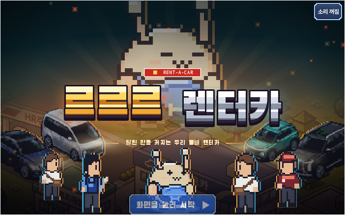
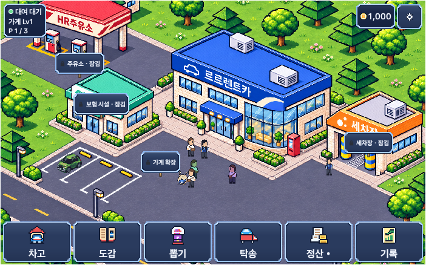

# 르르르 렌터카

**운전 중에는 안전하게, 주차 후에는 내 렌터카 가게를 키우는 차량용 방치형 경영 게임**

출퇴근길과 장거리 여행이 끝나면, 작은 렌터카 가게의 사장이 되어 보세요. 이동할 목적지에 맞춰 탁송 의뢰를 선택하고, 도착 후 받은 게임머니와 새 차량으로 가게를 키워 나갑니다. 모은 차량은 손님에게 자동으로 대여되고, 영업으로 번 수익은 다시 차량 수집과 가게 확장으로 이어집니다.

르르르 렌터카는 일상적인 운행 속에서 안전운전과 충분한 휴식을 꾸준히 실천하도록 돕고자 기획했습니다. 운전 중에는 게임 조작을 요구하지 않고, 주차한 뒤 보상과 성장한 가게를 확인하며 즐기는 게임입니다.

[게임 콘텐츠](#게임-콘텐츠) · [다운로드](#다운로드) · [시작하기](#시작하기)

## 게임 화면

### 시작 화면

### 메인 게임 화면

[▶ 게임 시연 영상 보기](https://github.com/Yaho03/drive-growth/releases/download/integrated-20261115-52285de/rrr-rentcar-demo.mp4)

## 게임 콘텐츠

- **목적지와 연결되는 탁송 의뢰** — 원래 이동하려던 목적지에 맞는 의뢰를 고릅니다. 수익 탁송으로 게임머니를 벌거나, 구매 탁송으로 원하는 차량을 가게에 데려올 수 있습니다.
- **차량 수집과 도감** — 탁송과 뽑기로 다양한 차종·희귀도의 차량을 모읍니다. 도감에는 발견한 차량과 한 번이라도 보유한 기록이 남습니다.
- **자동 렌터카 영업** — 보유 차량을 가상의 손님에게 대여합니다. 주차 후 대여 결과와 영업 수익을 확인하고 다음 영업을 준비합니다.
- **차량 성장과 관리** — 차량을 강화하고, 수리하거나 판매·폐차하면서 차고를 관리합니다. 같은 차종도 개별 차량으로 수집할 수 있습니다.
- **가게 확장과 꾸미기** — 주차 공간을 넓히고 주유소·보험·세차장 등의 시설을 설치합니다. 차량과 시설이 늘어나는 모습을 가게 지도에서 확인할 수 있습니다.
- **휴식과 보너스** — 휴식 중인 르르르의 모습과 휴식 진행 상황을 확인합니다. 휴식 후 다음 출발에 적용되는 수익 보너스를 모의 체험할 수 있습니다.
- **퀘스트·업적과 내 기록** — 목표를 달성해 보상을 받고, 수익·보유 차량·도감 수집 등 가게의 성장 기록을 확인합니다.

안전운전 추가 보상은 향후 계획입니다. 실제 차량의 운전 습관과 휴식 장소를 판단하는 기능은 지원 API와 검증 결과에 맞춰 연결할 예정입니다.

## 다운로드

[**게임 체험 APK 다운로드**](https://github.com/Yaho03/drive-growth/releases/download/integrated-20261115-52285de/rrr-rentcar-firstcarplay-52285de.apk) · [**차량 연동 APK 다운로드**](https://github.com/Yaho03/drive-growth/releases/download/integrated-20261115-52285de/rrr-rentcar-vehicle-fresh-install-52285de.apk) · [전체 릴리스](https://github.com/Yaho03/drive-growth/releases/tag/integrated-20261115-52285de)

- **게임 체험 APK:** Pleos 에뮬레이터에서 모의 차량·내비 입력으로 게임을 체험하는 Debug 앱입니다.
- **차량 연동 APK:** 실제 Pleos SDK 입력을 사용하는 개발 서명 Release입니다. 기존 차량용 앱과 서명이 달라 별도 환경에 신규 설치해야 하며, Pleos 에뮬레이터에서 신규 설치와 실행을 확인했습니다.

## 시작하기

1. Pleos 에뮬레이터에 **게임 체험 APK**를 설치하고 앱 목록에서 **르르르 렌터카 · 첫 차량 테스트**를 엽니다.
2. 시작 화면을 누르고 첫 차량을 선택해 렌터카 가게를 엽니다.
3. **설정 → 시연**의 모의 입력 도구로 탁송·휴식·주차 후 정산을 체험합니다.

[설치 방법과 단계별 체험 안내](docs/05_DEVELOPMENT_SETUP.md#심사위원-실행-안내)

## 실행 환경

| 항목 | 환경 |
| --- | --- |
| 대상 | Pleos Connect 차량용 앱 |
| 시험 에뮬레이터 | Pleos Connect Emulator 2.1.0 · Android API 34 · ARM64 |
| 화면 규격 | 디스플레이 1080×600px · 120dpi, 시험한 앱 창 702×438px |
| 체험 설정 | 게임 체험 APK의 **설정 → 시연**에서 모의 입력 사용 |
| 차량 연동 설정 | 차량 데이터 권한·시스템 조작 허용 필요. 기어 P와 정차 확인 후 게임 조작 가능 |

현재 체험은 모의 입력을 사용하며 랭킹은 예시 데이터입니다. 실제 내비 도착과 보상 지급의 전체 연결 및 실차 시험은 확인이 남아 있습니다. [검증 범위](docs/06_VERIFICATION.md#현재-검증-요약--2026-11-15)

## 더 알아보기

[게임 기획](docs/01_PRD.md) · [설치·빌드 안내](docs/05_DEVELOPMENT_SETUP.md) · [전체 문서](docs/README.md) · [현대자동차그룹 공모전 제출 안내](https://appdevchallenge.auto-hmg.io/guide/submission)
