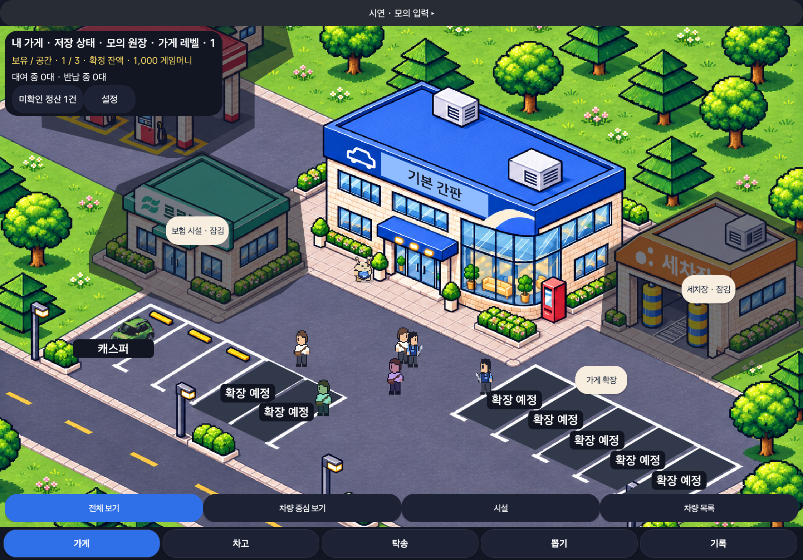

# 드라이브 키우기

평소 이동을 탁송과 수익으로 연결하고, 주차 후 차량을 모아 렌터카 가게를 키우는 **Pleos Connect 차량용 경영 게임**입니다. 현대자동차그룹 차량용 앱 개발 공모전을 위해 Kotlin과 Android Views로 개발하고 있습니다.

## 실제 화면과 시연

Pleos 에뮬레이터의 가로 창에서 **모의 입력**으로 실행한 `af2118e`의 가게 지도입니다. 화면에서 차량과 시설을 선택하고, 하단의 가게·차고·탁송·뽑기·기록 메뉴로 이동합니다. 차량용 빌드의 실행 화면과 각 시험의 입력 출처는 검증 기록에서 확인할 수 있습니다. [가게 UI 통합 검증](docs/06_VERIFICATION.md#새-가게-ui의-통합-확인-항목--2026-11-13)

아래 모의 시연 다운로드는 기존 `ba38def` 빌드입니다. 차 없이 체험하려면 이 APK를 설치해 **드라이브 키우기 · 모의 시연**을 여세요. 첫 차량을 선택한 뒤 **탁송 → 시연 목적지 확인 → 수익 탁송 선택 확정**을 진행합니다. 선택이 저장되면 **처리 결과 확인하고 새로 조회**를 누릅니다. **시연 · 모의 입력**에서 **모의주행 시작**을 누르고 모의 주차가 끝나면 탁송 결과와 미확인 정산을 확인하세요. 같은 앱을 다시 열어 저장된 결과를 볼 수 있습니다. [설치·재실행 순서](docs/05_DEVELOPMENT_SETUP.md#별도-모의-시연-debug-apk)

지도·패널과 다섯 메뉴의 배치·입력 장치 시험이 통과했습니다. [화면과 기능 연결](docs/09_UI_UX_SPEC.md#새-가게-지도와-기능-연결--2026-11-13) · [좁은 창·세로 창 수정과 실제 화면](docs/06_VERIFICATION.md#최종-모의-apk의-좁은-가로세로-지도-패널--2026-11-13)

## 대상 사용자와 해결할 문제

일상 이동을 돌아보고 그 결과를 수집과 가게 성장으로 이어 가고 싶은 운전자가 대상입니다. 필요한 확인과 게임 조작은 주차 후에 모아, 평소 이동만으로 게임을 이어갈 수 있게 설계합니다.

## 차량용 앱이어야 하는 이유

차량의 속도·기어·플랫폼 UX 제한 상태로 주차 후 조작 가능한 시점을 구분합니다. 주차 중 목적지와 의뢰를 고르고, 운전 중에는 게임 UI·조작·연출을 제한합니다. 주차 후 돌아오면 확인된 결과를 읽고 차량과 가게를 관리합니다. 실제 내비 도착의 지급 조건과 주행 중 기록 정책은 추가 확인 범위입니다. [차량 입력과 안전 기준](docs/01_PRD.md#안전기술-확인과-남은-결정)

## 핵심 기능

- **탁송과 정산** · 수익 의뢰나 구매 의뢰를 고르고, 확인된 결과에서 게임머니·차량·임시 보관을 구분합니다. 자동 대여와 기본 주행 수익은 각각의 원정산에서 확인합니다.
- **차량 수집과 관리** · 첫 차량 선택, 뽑기, 차종×희귀도 도감, 개체별 강화·수리·판매·폐차를 제공합니다.
- **가게 성장과 기록** · 주차 공간을 확장하고 시설과 꾸미기를 확인합니다. 진행 보상과 내 기록을 제공하며, 시연용 랭킹과 향후 온라인 순위를 구분합니다. [제품 규칙](docs/01_PRD.md)

## 공모전과 개발 조건

- **2026-11-15 23:59 KST**까지 공식 접수양식의 기획서와 참가자별 동의·서명을 제출합니다. 시연 영상과 GitHub 소스·실행 가능한 Release APK는 선택 가산점 자료입니다. 1차 결과는 11월 23일, 2차 오프라인 PT는 12월 3~4일입니다. [일정·제출 상세](docs/contest/01_CONTEST_GUIDE.md) · [공식 제출 안내](https://appdevchallenge.auto-hmg.io/guide/submission)
- 공식 개발 조건은 **Android API 28 이상, Gradle 8.0 이상, Java 또는 Kotlin**입니다. 프로젝트 적용값은 **KGP 2.2.21, AGP 8.10.1, Gradle 8.11.1, JDK 17**입니다. Pleos 에뮬레이터 시험에는 2.1.0/API 34 ARM64를 사용했습니다. [공식 개발 안내](https://appdevchallenge.auto-hmg.io/guide/development) · [프로젝트 환경](docs/05_DEVELOPMENT_SETUP.md)
- 운영사무국은 공개 SDK 문서 범위에서 개발하고 문서에서 지원하지 않는 기능은 기획서의 향후 계획에 쓰도록 안내했습니다. SDK별 공개·제공·실행 근거와 App Market 심사는 구분합니다. [운영사무국 회신 기록](docs/contest/03_VEHICLE_API.md#45-navihelper-기술-문의-회신--2026-11-11-사용자-제공)

## 설치용 APK 다운로드

| 종류 | 받는 곳과 실행 |
|---|---|
| 배포된 모의 시연 Debug `ba38def` | [APK 다운로드](https://github.com/Yaho03/drive-growth/releases/download/demo-20261113-ba38def/drive-growth-ba38def-debug.apk) · [Release와 해시](https://github.com/Yaho03/drive-growth/releases/tag/demo-20261113-ba38def). 저장소 접근 권한이 필요합니다. 패키지 `io.drivegrowth.app.simulation`을 시험 기기에 설치해 **드라이브 키우기 · 모의 시연**을 엽니다. |
| 현재 소스의 로컬 Debug | JDK 17과 Android SDK를 준비해 `./gradlew :app:assembleDebug`를 실행합니다. 산출물은 `app/build/outputs/apk/debug/app-debug.apk`입니다. |
| 새 가게 UI 로컬 시험 APK | `3358574`의 좁은·세로 패널 수정본을 모의 APK로 실행했습니다. [창별 화면·설치 해시](docs/06_VERIFICATION.md#최종-모의-apk의-좁은-가로세로-지도-패널--2026-11-13). 이전 `af2118e`의 화면·스크롤 시험과 `e55baad`의 Main 시연은 당시 근거로 구분합니다. [시험별 소스·APK 해시](docs/06_VERIFICATION.md#새-가게-ui의-통합-확인-항목--2026-11-13) |
| #287 로컬 검증 APK | 별도로 조립한 모의 Debug와 개발 서명 차량용 Release 구성을 시험했습니다. 차량용은 `io.drivegrowth.app`으로 Pleos 런처에서 실제 SDK 입력을 받습니다. [정확한 소스·해시·실행 조건](docs/06_VERIFICATION.md#차량용-첫-실행과-마을-주민-검증--2026-11-13) |

[APK 구분·설치·모의 플레이 전체 절차](docs/05_DEVELOPMENT_SETUP.md#별도-모의-시연-debug-apk). 제출용 서명과 실제 제출할 소스·APK의 조합은 [#29](https://github.com/Yaho03/drive-growth/issues/29)에서 확인합니다.

## 검증과 한계

- **모의 입력과 저장** · 같은 모의 프로필에서 첫 지급·탁송·정산·확장·진행 보상과 재실행을 확인했습니다. 해금용 자금·과거 대여·일부 차량은 시험 준비 입력입니다. [연속 실행 근거](docs/06_VERIFICATION.md#최종-동일-모의-원장의-연속-실행--2026-11-13)
- **Pleos 에뮬레이터** · #287에서 실제 SDK의 PARK·UX 허용, 권한 거부 및 복귀와 첫 지급 프로필 재실행을 확인했습니다. 공식 세로·가로 창의 첫 실행은 별도 모의 앱 시험입니다. [#287 실행 범위](docs/06_VERIFICATION.md#차량용-첫-실행과-마을-주민-검증--2026-11-13)
- **남은 범위** · 최종 제출 APK 확인, 시스템 회전·분할, 실제 SDK 목적지 변경 성공과 도착 지급, 전원·실차 및 App Market 승인 확인이 남아 있습니다. 게임 경제는 시연 시험값을 쓰며 온라인 랭킹은 후속 범위입니다. 배포·출품 자산의 사용 조건과 최종 제출 자료는 [#29](https://github.com/Yaho03/drive-growth/issues/29), 기능 간 회귀는 [#28](https://github.com/Yaho03/drive-growth/issues/28)에서 추적합니다.

## 문서 안내와 읽는 순서

| 필요한 내용 | 문서 |
|---|---|
| 제품 요구사항과 화면 | [01 제품 기준](docs/01_PRD.md) · [09 화면·기능 연결](docs/09_UI_UX_SPEC.md) |
| 저장·명령·데이터 | [02 기술 계약](docs/02_SYSTEM_ARCHITECTURE.md) · [차량 기준 데이터](docs/data/vehicles.csv) |
| 빌드·설치·시험 | [05 실행·설치](docs/05_DEVELOPMENT_SETUP.md) · [06 실제 검증·제출 준비](docs/06_VERIFICATION.md) |
| 분담·기능 이력 | [08 계획·인계](docs/08_PROJECT_PLAN.md) · [협업 기준](CONTRIBUTING.md) · [AI 작업 진입점](AGENTS.md) · [Claude 지침](CLAUDE.md) |
| 공식 자료·제출 초안 | [공모전·Pleos 자료](docs/contest/README.md) · [10 제출 문안](docs/10_SUBMISSION_DRAFT.md) · [내비 진단 APK](navi-diagnostic/README.md) |
| 조사·디자인 참고 | [03 게임 비교](docs/03_GAME_BENCHMARK.md) · [04 차량·권리 조사](docs/04_VEHICLE_RESEARCH.md) · [07 참고 자료](docs/07_REFERENCES.md) · [11 디자인 이력](docs/11_DESIGN_IMPLEMENTATION_STATUS.md) · [브라우저 시안](docs/design-assets/town-preview/README.md) · [경제 검토 제안](docs/proposals/b-economy/README.md) |
