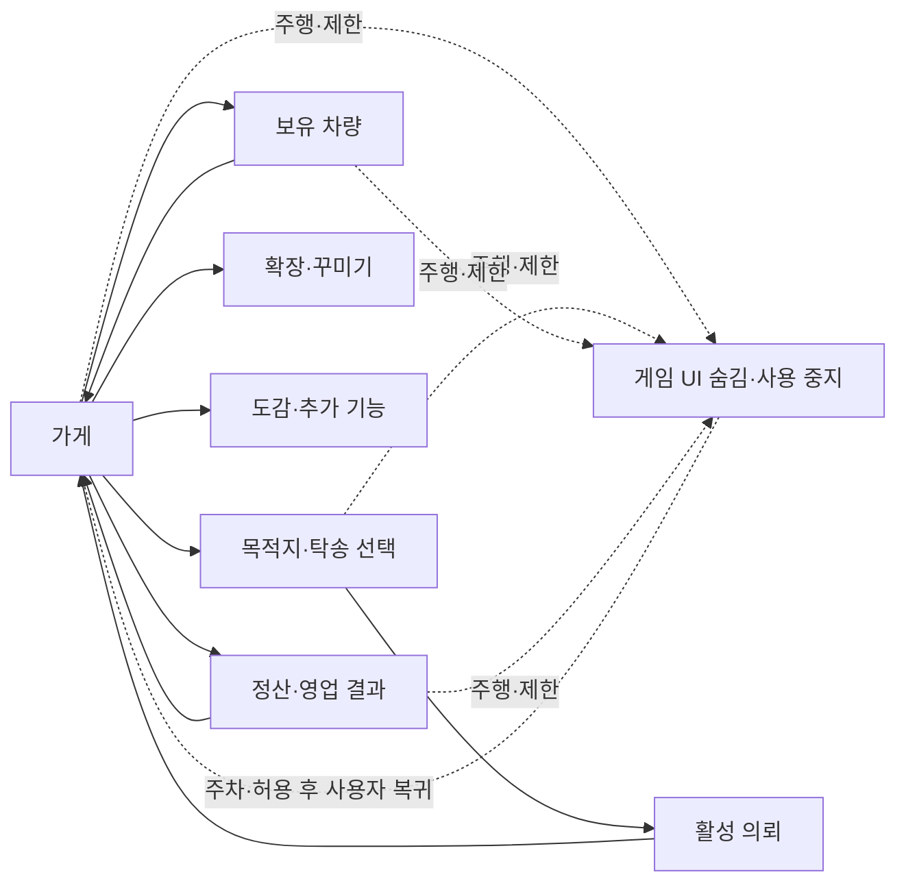

# 화면 흐름·디자인 명세

이 문서는 #18의 화면 설계 산출물이다. 제품·경제 규칙은 [PRD](01_PRD.md), 데이터·저장·호출 계약은 [기술 설계](02_SYSTEM_ARCHITECTURE.md), 실제 시험 결과는 [검증 문서](06_VERIFICATION.md)를 따른다. **와이어프레임·화면별 구현 기준을 작성했으며 앱 구현·사용성 시험·실차 검증은 아직 완료하지 않았다.**

## 1. UI 구현 기준과 산출물

첫 구현은 **Kotlin + Android Views 기반의 2D 화면**으로 구성하는 기준안을 채택한다. 현재 `DashboardView`가 Views를 사용하고 앱에 Compose 의존성이 없는 조건에서, 공통 데이터 계약·제한 처리·첫 흐름 검증을 먼저 연결하기 위한 선택이다. 가게는 한 장의 2D 배경과 개별 차량/슬롯/시설 상태를 조합한다. 차종별 전체 3D 모델·카메라·게임 엔진을 첫 연결의 선행조건으로 만들지 않는다. 향후 스타일·3D 확장은 별도 제품·성능 검토 대상이다.

| 비교 | 첫 구현에 미치는 영향 | 선택 |
|---|---|---|
| Android Views | 현재 코드·표준 위젯 활용, 추가 UI 의존성 없이 상태 표시·버튼·화면 연결 가능 | 첫 구현 기준 |
| Jetpack Compose | 선언형 상태 UI에 적합하나 현 프로젝트에는 설정·의존성·팀 학습이 추가로 필요 | 현재 도입하지 않음. 추후 필요 시 화면 단위 검토 |
| 별도 게임 엔진/3D | 자산·렌더링·메모리·차량 폼 팩터 검증 범위 확대 | 첫 흐름의 필수 기반으로 채택하지 않음 |

이는 공식 의무 기술이 아니라 프로젝트의 초기 구현 결정이다. Views는 XML 또는 프로그램에서 View/ViewGroup을 구성할 수 있고, Compose는 기존 Views와 점진적으로 함께 사용할 수 있다. 근거: [Android Views 레이아웃](https://developer.android.com/develop/ui/views/layout/declaring-layout), [Compose 이전 전략](https://developer.android.com/develop/ui/compose/migrate/strategy). 확인일 2026-11-04. 이 문서 작업에서 Gradle 설정을 변경하지 않았다.

[핵심 화면 와이어프레임](design-assets/wireframes.svg)은 가게·보유 차량·탁송 선택·결과의 정보 우선순위를 보여준다. 외부 차량·로고·르르르 이미지를 사용하지 않은 자체 중립 도형이며, 표시 수치는 **레이아웃용 예시**다. 실차 외형·최종 미술 스타일·제품 밸런스로 사용하지 않는다.

### UI 시안 v3 — #24 결정 반영

2026-11-04 @hoyeol903이 Claude Design으로 작성한 시안을 화면별 PNG로 보관한다([`design-assets/ui-v3/`](design-assets/ui-v3/)). PRD의 #24 결정을 화면에 반영한 **시안**이며 앱 구현·사용성 검증이 아니다. 기존 `wireframes.svg`를 대체할지는 화면 담당(D)과 리뷰에서 정한다.

| 구분 | 크기 | 화면(파일 접두 ID) |
|---|---|---|
| 세로형 | 840×1184dp (일부 상태 카드는 폭 840) | 4a 가게 홈 · 4b 영업 상태 문구 · 4c 휴게소에서 열었을 때 · 4d 차고 · 4e 차량 상세 · 4f 강화 · 4g 사고 3회 이상 폐차만 · 4h 구매 탁송 확인 · 4i 진행 중 탁송 · 4j 변경 기회 사용 후 · 4k 목적지 변경 차액 · 4l 미도착 기한 만료 · 4m 정산 · 4n 정산 상세 · 4o 시설 · 4p 차량 뽑기 · 4q 첫 실행 · 4r 퀘스트·업적 · 4s 랭킹 · 4t 휴식 보너스 설명 |
| 가로형 | 1360×948dp | 4u 가게 홈 · 4v 차고 · 4w 구매 탁송 확인 · 4x 진행 중 탁송 · 4y 정산 · 4z 시설 · 5a 뽑기 · 5b 첫 실행 · 5c 퀘스트·업적 · 5d 랭킹 |

- 크기 기준은 Pleos 폼 팩터 가이드의 예시 테스트 화면(17" 세로형 840×1184dp, 14.6" 가로형 1360×948dp)이다. 다른 프리셋에서의 배치는 앱 구현 후 확인한다.
- 3D 가게·차량·캐릭터는 시안용 **임시 오리지널 그림**이며 실제 차종 외형이나 공식 르르르 이미지가 아니다. "르르르" 이름과 공식 이미지 사용은 #19 확인 전이다.
- 화면 속 금액·진행도는 예시이고 규칙 수치는 PRD를 따른다. 시안과 PRD가 다르면 PRD가 기준이며, 확인된 차이: 4p의 뽑기권 가격 표시(3,000)는 PRD 시험값 500과 다르다. 일반 첫 차량·개별 희귀도·차종×희귀도 도감과 처분/랭킹 금액 구분도 아래 최신 구현 기준으로 적용하며, 기존 PNG가 갱신됐다는 뜻은 아니다.
- 원본은 Claude Design 프로젝트 "Drive Growth 와이어프레임"(작성자 계정 전용 공유)이며, 렌더링에 Claude Design 실행 스크립트가 필요해 원본 HTML은 저장소에 넣지 않는다.

## 2. 공통 상태·진입·이탈

조작 가능한 모든 게임 화면은 **주차 + 플랫폼 UX 허용 + 필요한 신호의 유효성**을 확인한 뒤 표시한다. 속도 0·P 기어 하나만으로 허용하지 않는다. 화면 상태와 게임 기록 상태를 분리하며 주행 중 기록 지속·음성 허용은 [차량 정책](contest/03_VEHICLE_API.md), [음성 정책](contest/02_PLEOS_DEVELOPMENT.md)을 따른다.

| 화면 상태 | 진입 | 표시·입력 | 종료 |
|---|---|---|---|
| 확인 중 | 최초 실행·복귀·신호 만료 | 게임 콘텐츠/조작을 열기 전 상태 확인. 이전 잔액을 0으로 바꾸지 않음 | 현재 허용 판단 수신 |
| 주차·사용 가능 | 유효한 주차/UX 허용 판단 | 선택한 주차 화면 표시 | 주행·제한·신호 불명 시 게임 UI 숨김/사용 중지 |
| 사용 제한 | 주행·UX 제한 또는 필요한 상태 불명 | 게임 화면·게임 버튼·성장 연출 없음. 오류 팝업으로 우회하지 않음 | 주차·허용 후 사용자가 앱에 복귀 |
| 처리 중 | 사용자가 확정 요청 | 해당 요청 중복 실행 차단. 저장 성공 전 완료 연출 없음 | 확정 결과 또는 오류 |
| 복구 필요 | 저장·데이터 오류 | 주차 허용 상태에서 복구 설명. 미확정 보상은 대기 표시 | 재시도·조회·이전 화면 |

`사용 제한`은 새 주행용 게임 화면의 이름이 아니다. 실제 Activity 숨김·재진입 차단 방식은 #13 플랫폼 시험으로 확인한다. 주차가 앱 자동 전면 실행을 의미하지 않는다. 이전 ‘수련’은 현재 화면명으로 사용하지 않는다.

## 3. 화면별 레이아웃과 행동

가로형은 상단 요약·좌측 탐색·중앙 본문·우측 문맥 패널을 기본으로 한다. 좁은 창에서는 문맥 패널을 상세 화면으로 이동하고 본문을 한 열로 바꾼다. 실제 디스플레이 픽셀을 고정하지 않으며 레이아웃 분기점은 실기기/에뮬레이터 확인 후 조정한다.

| 화면 | 우선 표시할 정보·배치 | 행동과 전환 | 데이터·제한 |
|---|---|---|---|
| 가게 | 상단 가게명·잔액·공간·미확인 결과. 중앙은 차량이 잘 보이는 가게 전체. 우측은 활성 의뢰·시설 요약 | `차량 보기`→차고, `탁송 선택`→목적지, `확장·꾸미기`→관리, `결과 N건`→결과 | 미확인 결과 수와 잔액은 조회값. 결과를 여는 것으로 재지급하지 않음 |
| 보유 차량·차고 | 차량 카드 격자: 이름·개체 식별 보조표시·레벨·대여/수리 상태. 선택 카드 상세에 사고 이력·행동 | `상세`→개체 상세, `강화/수리/판매/폐차`→효과·비용 확인→확정. 가게로 복귀 | 같은 차종 두 대를 별도 개체로 표시. 대여 중 처분 등 미정 정책은 허용으로 추정하지 않음 |
| 목적지·탁송 목록 | 상단 목적지/예상 거리, 본문 `수익 탁송`·`차량 구매` 후보, 우측 선택안의 금액·획득·완료 조건 | `목적지 선택`→허용된 입력 경로, `선택`→상세, `의뢰 확정/구매 확정`→활성 의뢰 | 후보 없음을 네트워크 오류와 구분. 목적지 입력/경로 API는 #13 확인 필요. 예상 거리와 실제 이동 거리 혼용 금지 |
| 활성 의뢰 | 선택 차량·의뢰 유형·목적지·완료 상태·변경 기회. 변경 전후 조건 비교는 한 화면에 표시 | 주차 중 `목적지 변경` 또는 `포기`→명시적 확인. 변경 후보 재선택 후 확정 | 변경의 희귀도 하락과 취소의 수수료를 구분. 구매 변경 차액 미정은 `정책 확인 필요`로 설계 대기 |
| 정산·영업 결과 | 상단 총 결과 요약, 본문 기본 주행/탁송/렌트/시설 수익 구분. 영입 차량, 리뷰·단골 정보·가상 사고 내역 | 짧은 결과 연출 후 `요약 보기`, `상세`, `가게로`. 과거 결과 조회 가능 | 확정 정산만 완료 표시. 결과/열람 여부 분리. 운전자 사고·실제 안전 평가처럼 표현하지 않음 |
| 확장·꾸미기 | 가게 미리보기, 항목별 현재/변경 후 모습·공간·시설 조건·비용 | `미리보기`→배치안, `적용 확인`→거래, `취소`→원상 복귀 | 실제 승인되지 않은 외형은 자리표시자. 결제 전 미리보기와 확정 적용 구분 |
| 도감·가챠·퀘스트·업적·랭킹 | 가게 탐색에서 접근하는 하위 기능. 수집/잠금/진행/보상/집계 출처 표시 | 각 상세와 청구/추첨 확인은 주차 중. 선택한 결과는 보존 | #24의 구체 규칙·온라인 범위에 맞춰 상세화. 핵심 요구를 누락하거나 미정 기능을 완료로 표시하지 않음 |

가게는 전체 보기와 차량 중심 보기를 전환해 수집 결과를 확인하게 한다. 사용자 입력 한 번에 하나의 명령만 보내며 상태 갱신을 받아 화면을 다시 그린다. 무거운 연산·저장·거래를 View 내부에서 수행하지 않는다. 기능별 화면과 공통 탐색의 파일 담당은 #25에서 정한다.

### 첫 실행

최초 실행에서 저장 조회·주차 허용 확인 후 첫 안내를 연다. 캐스퍼·아반떼 선택 후보, 첫 지급 희귀도 일반·취득 기준액 0, 개업 선물 뽑기권과 초기 재화/공간은 [PRD의 시작 경험·주요 기능](01_PRD.md#시작-경험과-주요-기능)을 따른다. 설계는 **안내→후보 비교→선택 확인→저장 성공→가게**로 잡고 확인 후 선택 취소 불가와 프로필당 1회 지급을 표시한다. 첫 성장의 순서·비용 등 남은 결정은 #24에서 정하며 화면 예시로 확정하지 않는다. 재실행은 초기 지급을 반복하지 않아야 한다. 차량 신호/권한 안내를 주행 중 튜토리얼 관문으로 띄우지 않는다.

### 차량 정보·도감·처분·랭킹 표시

2026-11-07 PRD 결정을 반영한 구현 기준이다. 1차 차종·게임 유형·가격 비율·해금 배치는 [PRD의 차량 표](01_PRD.md#1차-차종가격-비율해금-배치)를 사용하고, 실제 금액은 수익 단위 결정과 검증된 콘텐츠 공급 후 표시한다. B 경제 제안이나 시안 예시를 제품 가격으로 합치지 않는다. 도감은 차종×희귀도별 발견·보유 이력을 표시하고 처분 뒤에도 보유했음 기록을 유지한다. 목록·필드·이력 저장의 실제 연결과 검증은 #35·#46·#52의 완료 조건으로 남긴다.

판매·폐차 확인은 차종 가격과 별도로 실제 취득 기준액·예상 지급액을 표시한다. 무료·첫 지급은 취득 기준액 0, 할인 뽑기권은 실제 할인가를 사용하며 UI가 금액을 재계산하지 않는다. 「가장 비싼 차」는 현재 보유 차량의 차종 가격×희귀도 수익 배율 중 최댓값을 조회해 표시하므로 무료 취득가 0과 혼동하지 않는다. 나머지 지표의 정의·동률·온라인 범위는 #24·#58의 결정과 연결 검증을 따른다.

### 요청 확인과 Back

비용·소비가 있는 요청의 확인 패널은 대상 개체, 비용, 예상 결과, 되돌릴 수 없는 변화, `확정/돌아가기`를 표시한다. 서버/저장 요청 전에 확인을 완료한다. 재시도는 같은 요청 ID를 재사용하며 버튼을 새 요청으로 반복 전송하지 않는다.

Back은 확인 패널 닫기→직전 화면→최상위 동작 순으로 처리한다. 처리 중에는 중복 전송을 막고 화면을 떠나더라도 거래 결과는 조회로 복원한다. CCP·최상위 숨김 동작은 [공식 자료](contest/04_OFFICIAL_RESOURCES.md)의 정책과 #13 시험 결과를 따르며 실제 입력 검증은 남아 있다.

## 4. 공통 실패·빈 상태

| 상황 | 표시 | 가능한 행동·해제 조건 |
|---|---|---|
| 초기 로딩 | 해당 영역의 준비 중 표시, 이전 확정값을 0으로 대체하지 않음 | 취소 가능한 조회만 돌아가기. 확정 거래와 구분 |
| 보유/기록 없음 | 차량 지급 전·첫 영업 전 등 원인을 설명 | 가게/안내 보기. 추가 주행을 요구하는 카운트다운 사용 안 함 |
| 권한 거부·신호 미지원 | 확인 불가 항목과 영향받는 기능만 구분 | 주차 중 권한/연결 안내·재확인. 공통 상태가 `ALLOWED`일 때만 게임 조작 허용. [차량 표본·화면 잠금 계약](02_SYSTEM_ARCHITECTURE.md#차량-표본화면-잠금도착-증거-계약) 참조 |
| 후보 없음·경로 실패 | `후보 없음`과 `경로 정보를 확인하지 못함`을 구분 | 목적지 재선택/다시 조회. 임의 거리·희귀도 생성 금지 |
| 잔액·공간 부족 | 필요한 값과 현재 값이 확인된 경우에만 비교 표시 | 다른 후보 선택/가게로. 추가 운전 재촉 안 함 |
| 상태 충돌 | 해당 차량/의뢰가 다른 상태로 바뀌었음을 설명 | 최신 상태 다시 조회. 처분·환급을 자동 반복하지 않음 |
| 저장 실패 | `확정되지 않음`·조회/재시도 안내 | 같은 요청 ID로 복구. 성공 연출·잔액 증가를 먼저 표시하지 않음 |
| 데이터 누락·도착 증거 부족 | 확인한 기록과 대기 원인 표시 | 관련 의뢰 보존·재확인. 임의 보상/취소 정책은 #24에서 결정 |
| 복귀·재실행 | 미확인 결과·활성 의뢰·개체·꾸미기 상태 조회 | 이전 화면 복원보다 주차/UX 허용 확인 우선 |
| 주행 중 오류 | 게임 팝업·반복 알림 표시 안 함 | 주차·허용 후 사용자 복귀 시 설명 |

## 5. 호출·상태 계약 연결

아래 함수명은 [#27 기술 계약](02_SYSTEM_ARCHITECTURE.md)의 문서 제안과 연결하며 실제 코드 API가 존재한다는 뜻은 아니다. 최종 타입·서명은 공통 계약 구현 이슈에서 확정한다.

| 화면 동작 | 연결 계약 | UI가 직접 하지 않는 일 |
|---|---|---|
| 차고·대여 가능 차량 조회 | `listOwnedVehicles` | 차량 개체 생성·대여 점유 변경 |
| 탁송 목록·변경 요청 | `proposeDelivery` / `changeDelivery` | 경로 거리 추정·희귀도·환급 계산 |
| 영업 결과 표시 | `calculateRentalResult`의 확정 저장 결과 조회 | 계산 결과안만으로 잔액 증가 |
| 강화·수리·처분 확인 | `prepareVehicleChange` → `commitGameChange` | 잔액·차량 DB 직접 수정 |
| 구매·영업·가게 거래 결과 | 공통 `commitGameChange`의 결과/오류 | 화면별 별도 저장·중복 지급 |
| 결과 목록·열람 | `listPendingResults` / `markResultViewed` | 결과 확인으로 재정산 |

화면 상태는 `Loading / Content / Empty / RecoverableError / Restricted`와 요청 중 여부를 구분하는 안을 사용한다. 이것은 화면 표현을 위한 분류이며 게임의 의뢰·대여 상태 enum과 혼합하지 않는다. `requestId`·개체 ID·revision·입력 출처를 명령 경계에서 보존한다.

## 6. 최초 디자인 기준

다음 값은 첫 화면 구현과 가독성 검토를 위한 **초기 기준**이다. 공식 Pleos 최소치나 실차 검증 결과로 주장하지 않는다. 최종 브랜드/그림체는 팀 검토 대상이며 가게·차량 권리 확인 후 적용한다.

| 항목 | 첫 구현 기준 |
|---|---|
| 분위기 | 차가 잘 보이는 작은 가게, 차분한 배경과 명확한 상태. 캐릭터는 사장 안내 위치에 한정하고 주행 중 반응 연출 없음 |
| 색 | 배경 `#0C1722`, 패널 `#172634`, 본문 `#E8F0F4`, 보조 `#9DB1C0`, 주요 행동 `#75E8BE`, 주의 `#F2C879`, 오류 `#F08C8C`. 색만으로 대여/수리/오류를 구분하지 않고 텍스트 병기 |
| 글자 | 시스템 sans-serif. 화면 제목 32sp, 주요 수치 30sp, 본문·버튼 24sp, 보조 20sp를 시작값으로 사용. 긴 차종명은 핵심 식별자를 유지하고 상세에서 전체 표시 |
| 여백 | 바깥 24dp, 큰 영역 간 24dp, 카드 내부 16dp, 항목 간 12dp. 좁은 창에서 글자를 먼저 줄이기보다 열을 줄이고 상세로 분리 |
| 버튼 | 초기 높이 64dp 이상, 인접 행동 간 16dp. 주요 확정 행동 한 개를 강조하고 비용/취소·처분은 확인 단계 제공 |
| 카드 | 이름→상태→핵심 수치 순서. 실제 차종 외형 확보 전 중립 차량 도형. 동일 차종은 개체별 선택 상태 명확히 표시 |
| 성장 표현 | 주차·UX 허용 후 짧은 정적 전환/페이드와 요약. 필수 정보는 애니메이션 없이 읽을 수 있게 하고 반복 점멸·긴 보상 연쇄 없음 |
| 화면 크기 | 가로형 2열/3열과 좁은 1열 구조. 시스템 영역을 피하고 실제 사용 가능 dp 크기로 검토. 포커스·선택·현재 화면 상태 유지 |

## 7. 자산과 구현 전 확인

| 자산 | 현재 사용/계획 | 권리·상태 |
|---|---|---|
| 와이어프레임 도형 | [wireframes.svg](design-assets/wireframes.svg) | 이 프로젝트에서 작성한 중립 도형. 실제 차종/가게 아트 아님 |
| UI 시안 v3 | [ui-v3/](design-assets/ui-v3/) 화면 PNG 30개 | 팀원이 Claude Design으로 작성한 시안. 3D 그림·캐릭터는 임시 오리지널, "르르르" 이름 사용은 #19 확인 전 |
| 차량·르르르·가게 아트 | #19의 확인 결과에 따라 적용 | [차량 조사](04_VEHICLE_RESEARCH.md) 참조. 공식 사이트 자료 발견은 사용 허가와 구분 |
| Pleos UI·CCP 참고 | [공식 자료 목록](contest/04_OFFICIAL_RESOURCES.md) | Figma 내부/개별 재사용 조건 미확인 |

## 8. 검토 절차와 완료 판단

| 확인 | 절차·기대 결과 | 현재 결과 |
|---|---|---|
| 문서·도형 연결 | 네 핵심 화면과 전환·버튼을 SVG/명세에서 대조 | XML 파싱·PNG 렌더·작성자 시각 점검 완료. 겹침/잘림 미발견. 실제 사용자 검토 미실시 |
| 계약 경계 | 각 행동의 입력/결과·저장 책임을 #27과 대조 | 문서 연결 작성. 최종 API·가짜 구현 미완료 |
| 제한 상태 | 게임 중 주행 전환·재진입·정차·주차·신호 만료 | #13과 앱 연결 후 실행 필요 |
| 폼 팩터 | 가로·좁은 창·방향/크기 변경·가상 디스플레이 제거 후 복원 | 공식 도구 preset·dp/DPI로 실행 필요 |
| 가독성·입력 | 제목·상태·확정 행동, 긴 이름·오류, 터치/지원 입력 탐색 | 초기 값의 실기기 가독성·입력 시험 미실시 |
| 복원·거래 실패 | 결과 열람·중복 탭·저장 실패·강제 종료 | #28 통합 검증에 연결 |

폼 팩터 도구 조건과 디스플레이 제거에 따른 종료는 [공식 자료 6절](contest/04_OFFICIAL_RESOURCES.md)을 따른다. 와이어프레임의 고정 캔버스가 모든 화면 크기에서의 성공을 의미하지 않는다. 화면 구현 완료는 앱의 연결과 위 실행 검증 근거가 확보된 뒤 판단한다.

문서 작업 확인: `python3 scripts/check_repository.py` 통과, SVG XML 파싱 통과, `rsvg-convert`로 PNG 변환 후 네 패널의 글자·버튼·차량 도형과 하단 제한 안내를 시각 점검했다. 이 확인은 실제 앱 렌더링·터치·사용성 시험과 구분한다.
