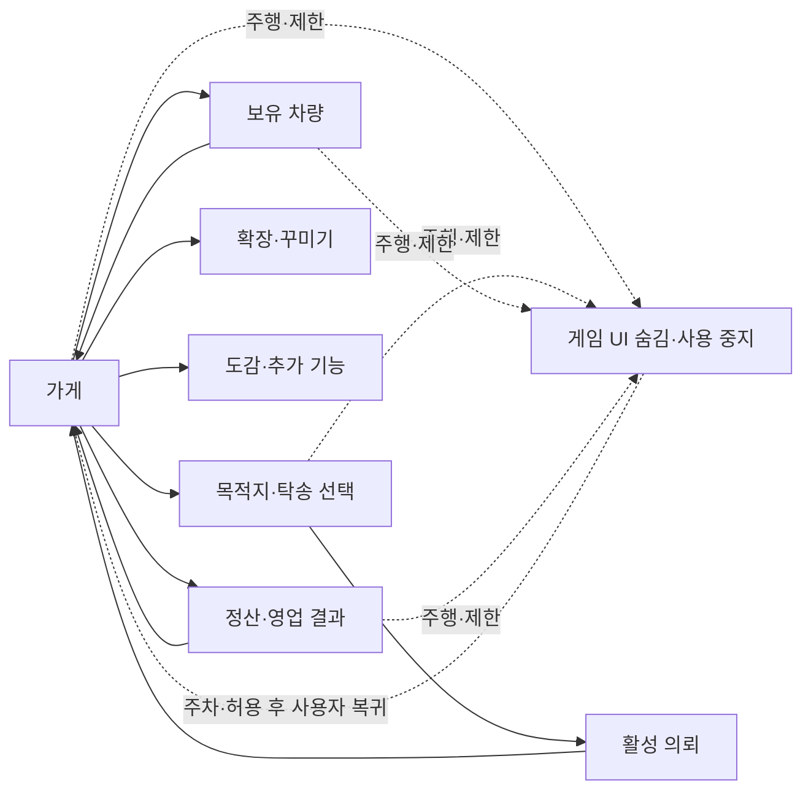

# 화면 흐름·디자인 명세

이 문서는 #18의 화면 설계 산출물이다. 제품·경제 규칙은 [PRD](01_PRD.md), 데이터·저장·호출 계약은 [기술 설계](02_SYSTEM_ARCHITECTURE.md), 실제 시험 결과는 [검증 문서](06_VERIFICATION.md)를 따른다. **와이어프레임·화면별 구현 기준을 작성했으며 앱 구현·사용성 시험·실차 검증은 아직 완료하지 않았다.**

## 1. UI 구현 기준과 산출물

첫 구현은 **Kotlin + Android Views 기반의 2D 화면**으로 구성하는 기준안을 채택한다. 현재 `DashboardView`가 Views를 사용하고 앱에 Compose 의존성이 없는 조건에서, 공통 데이터 계약·제한 처리·첫 흐름 검증을 먼저 연결하기 위한 선택이다. 가게는 한 장의 2D 배경과 개별 차량/슬롯/시설 상태를 조합한다. 차종별 전체 3D 모델·카메라·게임 엔진을 첫 연결의 선행조건으로 만들지 않는다. 향후 스타일·3D 확장은 별도 제품·성능 검토 대상이다.

| 비교 | 첫 구현에 미치는 영향 | 선택 |
|---|---|---|
| Android Views | 현재 코드·표준 위젯 활용, 추가 UI 의존성 없이 상태 표시·버튼·화면 연결 가능 | 첫 구현 기준 |
| Jetpack Compose | 선언형 상태 UI에 적합하나 현 프로젝트에는 설정·의존성·팀 학습이 추가로 필요 | 현재 도입하지 않음. 추후 필요 시 화면 단위 검토 |
| 별도 게임 엔진/3D | 자산·렌더링·메모리·차량 폼 팩터 검증 범위 확대 | 첫 흐름의 필수 기반으로 채택하지 않음 |

이는 공식 의무 기술이 아니라 프로젝트의 초기 구현 결정이다. Views는 XML 또는 프로그램에서 View/ViewGroup을 구성할 수 있고, Compose는 기존 Views와 점진적으로 함께 사용할 수 있다. 근거: [Android Views 레이아웃](https://developer.android.com/develop/ui/views/layout/declaring-layout), [Compose 이전 전략](https://developer.android.com/develop/ui/compose/migrate/strategy). 확인일 2026-11-04. 이 문서 작업에서 Gradle 설정을 변경하지 않았다.

[핵심 화면 와이어프레임](design-assets/wireframes.svg)은 가게·보유 차량·탁송 선택·결과의 정보 우선순위를 보여준다. 외부 차량·로고·르르르 이미지를 사용하지 않은 자체 중립 도형이며, 표시 수치는 **레이아웃용 예시**다. 실차 외형·최종 미술 스타일·제품 밸런스로 사용하지 않는다.

### UI 시안 v3 — #24 결정 반영

2026-11-04 @hoyeol903이 Claude Design으로 작성한 시안을 화면별 PNG로 보관한다([`design-assets/ui-v3/`](design-assets/ui-v3/)). PRD의 #24 결정을 화면에 반영한 **시안**이며 앱 구현·사용성 검증이 아니다. 기존 `wireframes.svg`를 대체할지는 화면 담당(D)과 리뷰에서 정한다.

| 구분 | 크기 | 화면(파일 접두 ID) |
|---|---|---|
| 세로형 | 840×1184dp (일부 상태 카드는 폭 840) | 4a 가게 홈 · 4b 영업 상태 문구 · 4c 휴게소에서 열었을 때 · 4d 차고 · 4e 차량 상세 · 4f 강화 · 4g 사고 3회 이상 폐차만 · 4h 구매 탁송 확인 · 4i 진행 중 탁송 · 4j 변경 기회 사용 후 · 4k 목적지 변경 차액 · 4l 미도착 기한 만료 · 4m 정산 · 4n 정산 상세 · 4o 시설 · 4p 차량 뽑기 · 4q 첫 실행 · 4r 퀘스트·업적 · 4s 랭킹 · 4t 휴식 보너스 설명 |
| 가로형 | 1360×948dp | 4u 가게 홈 · 4v 차고 · 4w 구매 탁송 확인 · 4x 진행 중 탁송 · 4y 정산 · 4z 시설 · 5a 뽑기 · 5b 첫 실행 · 5c 퀘스트·업적 · 5d 랭킹 |

- 크기 기준은 Pleos 폼 팩터 가이드의 예시 테스트 화면(17" 세로형 840×1184dp, 14.6" 가로형 1360×948dp)이다. 다른 프리셋에서의 배치는 앱 구현 후 확인한다.
- 3D 가게·차량·캐릭터는 시안용 **임시 오리지널 그림**이며 실제 차종 외형이나 공식 르르르 이미지가 아니다. "르르르" 이름과 공식 이미지 사용은 #19 확인 전이다.
- 화면 속 금액·진행도는 예시이고 규칙 수치는 PRD를 따른다. 시안과 PRD가 다르면 PRD가 기준이며, 확인된 차이: 4p의 뽑기권 가격 표시(3,000)는 PRD 시험값 500과 다르다. 일반 첫 차량·개별 희귀도·차종×희귀도 도감과 처분/랭킹 금액 구분도 아래 최신 구현 기준으로 적용하며, 기존 PNG가 갱신됐다는 뜻은 아니다.
- 원본은 Claude Design 프로젝트 "Drive Growth 와이어프레임"(작성자 계정 전용 공유)이며, 렌더링에 Claude Design 실행 스크립트가 필요해 원본 HTML은 저장소에 넣지 않는다.

## 2. 공통 상태·진입·이탈

조작 가능한 모든 게임 화면은 **주차 + 플랫폼 UX 허용 + 필요한 신호의 유효성**을 확인한 뒤 표시한다. 속도 0·P 기어 하나만으로 허용하지 않는다. 화면 상태와 게임 기록 상태를 분리하며 주행 중 기록 지속·음성 허용은 [차량 정책](contest/03_VEHICLE_API.md), [음성 정책](contest/02_PLEOS_DEVELOPMENT.md)을 따른다.

| 화면 상태 | 진입 | 표시·입력 | 종료 |
|---|---|---|---|
| 확인 중 | 최초 실행·복귀·신호 만료 | 게임 콘텐츠/조작을 열기 전 상태 확인. 이전 잔액을 0으로 바꾸지 않음 | 현재 허용 판단 수신 |
| 주차·사용 가능 | 유효한 주차/UX 허용 판단 | 선택한 주차 화면 표시 | 주행·제한·신호 불명 시 게임 UI 숨김/사용 중지 |
| 사용 제한 | 주행·UX 제한 또는 필요한 상태 불명 | 게임 화면·게임 버튼·성장 연출 없음. 오류 팝업으로 우회하지 않음 | 주차·허용 후 사용자가 앱에 복귀 |
| 처리 중 | 사용자가 확정 요청 | 해당 요청 중복 실행 차단. 저장 성공 전 완료 연출 없음 | 확정 결과 또는 오류 |
| 복구 필요 | 저장·데이터 오류 | 주차 허용 상태에서 복구 설명. 미확정 보상은 대기 표시 | 재시도·조회·이전 화면 |

`사용 제한`은 새 주행용 게임 화면의 이름이 아니다. 실제 Activity 숨김·재진입 차단 방식은 #13 플랫폼 시험으로 확인한다. 주차가 앱 자동 전면 실행을 의미하지 않는다. 이전 ‘수련’은 현재 화면명으로 사용하지 않는다.



## 3. 화면별 레이아웃과 행동

가로형은 상단 요약·좌측 탐색·중앙 본문·우측 문맥 패널을 기본으로 한다. 좁은 창에서는 문맥 패널을 상세 화면으로 이동하고 본문을 한 열로 바꾼다. 실제 디스플레이 픽셀을 고정하지 않으며 레이아웃 분기점은 실기기/에뮬레이터 확인 후 조정한다.

| 화면 | 우선 표시할 정보·배치 | 행동과 전환 | 데이터·제한 |
|---|---|---|---|
| 가게 | 상단 가게명·잔액·공간·미확인 결과. 중앙은 차량이 잘 보이는 가게 전체. 우측은 활성 의뢰·시설 요약 | `차량 보기`→차고, `탁송 선택`→목적지, `확장·꾸미기`→관리, `결과 N건`→결과 | 미확인 결과 수와 잔액은 조회값. 결과를 여는 것으로 재지급하지 않음 |
| 보유 차량·차고 | 차량 카드 격자: 이름·개체 식별 보조표시·레벨·대여/수리 상태. 선택 카드 상세에 사고 이력·행동 | `상세`→개체 상세, `강화/수리/판매/폐차`→효과·비용 확인→확정. 가게로 복귀 | 같은 차종 두 대를 별도 개체로 표시. 대여 중 처분 등 미정 정책은 허용으로 추정하지 않음 |
| 목적지·탁송 목록 | 상단 목적지/예상 거리, 본문 `수익 탁송`·`차량 구매` 후보, 우측 선택안의 금액·획득·완료 조건 | `목적지 선택`→허용된 입력 경로, `선택`→상세, `의뢰 확정/구매 확정`→활성 의뢰 | 후보 없음을 네트워크 오류와 구분. 목적지 입력/경로 API는 #13 확인 필요. 예상 거리와 실제 이동 거리 혼용 금지 |
| 활성 의뢰 | 선택 차량·의뢰 유형·목적지·완료 상태·변경 기회. 변경 전후 조건 비교는 한 화면에 표시 | 주차 중 `목적지 변경` 또는 `포기`→명시적 확인. 변경 후보 재선택 후 확정 | 변경의 희귀도 하락과 취소의 수수료를 구분. 구매 변경 차액 미정은 `정책 확인 필요`로 설계 대기 |
| 정산·영업 결과 | 상단 총 결과 요약, 본문 기본 주행/탁송/렌트/시설 수익 구분. 영입 차량, 리뷰·단골 정보·가상 사고 내역 | 짧은 결과 연출 후 `요약 보기`, `상세`, `가게로`. 과거 결과 조회 가능 | 확정 정산만 완료 표시. 결과/열람 여부 분리. 운전자 사고·실제 안전 평가처럼 표현하지 않음 |
| 확장·꾸미기 | 가게 미리보기, 항목별 현재/변경 후 모습·공간·시설 조건·비용 | `미리보기`→배치안, `적용 확인`→거래, `취소`→원상 복귀 | 실제 승인되지 않은 외형은 자리표시자. 결제 전 미리보기와 확정 적용 구분 |
| 도감·가챠·퀘스트·업적·랭킹 | 가게 탐색에서 접근하는 하위 기능. 수집/잠금/진행/보상/집계 출처 표시 | 각 상세와 청구/추첨 확인은 주차 중. 선택한 결과는 보존 | #24의 구체 규칙·온라인 범위에 맞춰 상세화. 핵심 요구를 누락하거나 미정 기능을 완료로 표시하지 않음 |

가게는 전체 보기와 차량 중심 보기를 전환해 수집 결과를 확인하게 한다. 사용자 입력 한 번에 하나의 명령만 보내며 상태 갱신을 받아 화면을 다시 그린다. 무거운 연산·저장·거래를 View 내부에서 수행하지 않는다. 기능별 화면과 공통 탐색의 파일 담당은 #25에서 정한다.

### 첫 실행

최초 실행에서 저장 조회·주차 허용 확인 후 첫 안내를 연다. 캐스퍼·아반떼 선택 후보, 첫 지급 희귀도 일반·취득 기준액 0, 개업 선물 뽑기권과 초기 재화/공간은 [PRD의 시작 경험·주요 기능](01_PRD.md#시작-경험과-주요-기능)을 따른다. 설계는 **안내→후보 비교→선택 확인→저장 성공→가게**로 잡고 확인 후 선택 취소 불가와 프로필당 1회 지급을 표시한다. 첫 성장의 순서·비용 등 남은 결정은 #24에서 정하며 화면 예시로 확정하지 않는다. 재실행은 초기 지급을 반복하지 않아야 한다. 차량 신호/권한 안내를 주행 중 튜토리얼 관문으로 띄우지 않는다.

### #56 첫 실행 독립 표시 UI 연결점

2026-11-07 `app/ui/onboarding/OnboardingView`를 Android Views로 구현했다. `4q-first-run.png`·`5b-landscape-first-run.png`를 직접 열어 어두운 카드·보라색 주요 버튼을 참고하고, 기존 `GarageStyle`과 자체 중립 차량 vector를 재사용했다. 시안의 첫 뽑기·건너뛰기 흐름은 최신 PRD의 캐스퍼/아반떼 선택·한 번 확인·지급 확정 흐름으로 맞췄다. 3D 가게/캐릭터/실차 이미지는 넣지 않았다. 첫 성장 순서·비용을 새로 정하지 않는다.

- 진입점은 `OnboardingView(context, onEvent)`, `render(OnboardingScreenState, controlsEnabled): Boolean`, `handleBack(): Boolean`, `restoreSelection(VehicleId?)`다. 호스트는 프로필당 인스턴스를 유지하고 프로필이 바뀌면 새 View를 만든다. 후보·예정 혜택·완료 요약 목록은 호출자가 소유하는 표시 snapshot이며 다음 render 전까지 변경하지 않는다. 변경은 새 목록을 다음 render에 전달한다. `controlsEnabled`만 소비하며 차량 신호·허용 판정·DB를 직접 읽지 않는다. false이면 게임 콘텐츠·선택·버튼을 제거한다.
- 상태는 `Loading`, `Unavailable`, `Intro`, `Choosing`(빈 후보 포함), `Confirming`, `Submitting`, `LoadError`, `GrantError`, `Completed`다. 호스트가 신규 프로필임을 확인한 때만 Intro/Choosing을 공급한다. **빈 보유 목록·보유 수 0으로 신규 프로필을 추정하지 않는다.** 초기화 조회 API 미지원/미확인은 무행동 `Unavailable(message)`로, 읽기 실패는 재시도 가능 여부를 가진 LoadError로 구분한다.
- 후보는 공통 `VehicleDefinition`과 선택 허용·비교 설명/불가 사유를 공급받는다. 누락된 비교 설명·초기 재화/공간/선물 안내는 확인 불가로 표시한다. `plannedBenefits`는 **지급 예정 안내**이며 실제 잔액·보유·지급 완료가 아니다. 초기 1,000·3칸은 PRD 시험값이고 선물 1장도 실제 #50 지급과 구분한다. 화면이 계산하거나 지급하지 않는다.
- 이벤트는 `StartChoosing`, `SelectVehicle(vehicleId)`, `ReviewSelection(vehicleId)`, `ConfirmSelection(vehicleId)`, `Previous`, `Retry(vehicleId?)`, `GoToShop`이다. Select/Review는 지급 명령이 아니다. ConfirmSelection은 선택 ID와 확인 의사를 전달할 뿐이며 호스트가 #50·공통 저장 경로의 프로필/requestId·지급 마커·재시도 동일성을 관리한다.
- Confirming은 취소 불가·프로필당 1회 안내와 `backAllowed`를 표시한다. 확인 전 Previous로 후보를 바꿀 수 있으나 확인/복구 요청 중에는 중복 확인·후보 변경·내부 Back을 막는다. GrantError의 `changeAllowed`는 호스트가 미지급·변경 허용을 확인한 경우에만 true로 공급한다. 미확정 상태를 성공으로 바꾸지 않는다.
- 확인/복구 요청을 수신하면 호스트는 먼저 `Submitting(vehicleId, vehicleName?, sourceLabel)`을 render하고 실제 결과를 기다린다. `Retry(null)`은 초기/후보 재조회로 `Loading → 결과`를, ID가 있는 Retry는 **기존 지급 요청의 조회·복구**로 `Submitting → GrantError/Completed`를 사용한다. 같은 오류의 문구/출처 재표시만으로 잠금을 해제하지 않는다. 실제 실패가 같은 문구여도 중간 처리 상태를 거쳐 응답했음을 명시한다.
- Completed에는 호스트가 확정 저장을 확인한 공통 `OwnedVehicle`, 표시 이름·확정 요약·`alreadyGranted`·출처를 제공한다. 이미 지급된 프로필도 재선택을 열지 않고 가게 이동만 요청한다. View는 전달받은 개체의 희귀도·레벨·취득액을 표시하며 프로필 초기화·재화/차량·튜토리얼 완료를 자체 생성하지 않는다. 같은 완료 화면의 재표시/요약 갱신으로 가게 이동을 중복 요청하지 않는다.
- `render`가 false이면 다른 선택의 늦은 응답이나 완료 뒤 역행을 무시한 것이다. 제한 입력은 이 경우에도 적용한다. 이 ID 방어는 호스트의 프로필·requestId·시도 순서 검증을 대체하지 않는다. 특히 같은 차종의 이전 시도 응답은 호스트가 거른다. 저장된 UI 단계만으로 지급 성공을 추정하지 않는다.
- 호스트는 `selectedVehicleId`와 `pendingVehicleId`, 현재 단계·실제 requestId/프로필을 자신의 기존 복원 경계에 보존한다. 재생성 시 지급 여부를 확인하기 전에는 Loading/Unavailable, 확인 중 요청은 Submitting을 공급한다. `restoreSelection`은 선택 가능한 단계의 ID만 복원하며 확인/처리/완료의 확정 입력을 덮지 않는다. 처리 중 Back은 소비한다. 조회 오류 `LoadError`의 Back은 공통 호스트에 맡기며, 지급 오류 `GrantError`는 `changeAllowed=true`일 때 Previous를 보내고 false일 때 소비한다. Intro/Unavailable/Completed에서 내부 Back이 소비되지 않으면 공통 호스트의 부모 화면/최상위 정책을 따른다. 실제 Activity/CCP 정책은 #51 소유다.
- 사용 가능 폭 760dp 이상은 후보 2열, 그 미만은 1열로 줄인다. 이는 초기 구현 분기값이며 공식 규격이 아니다. 긴 문구는 줄바꿈하고 본문을 스크롤한다. 제한·선택·비활성은 문구와 버튼 상태로 함께 표현한다. 기기의 가로 앱 영역과 440dp 본문/큰 글꼴의 격리 검증은 06의 해당 절을 따른다.

호스트 연결 예시(아래 함수는 호스트가 구현할 연결 책임이다):

```kotlin
val onboarding = OnboardingView(context) { event ->
    when (event) {
        OnboardingEvent.StartChoosing -> loadCandidatesForConfirmedNewProfile()
        is OnboardingEvent.SelectVehicle -> saveSelectedVehicleId(event.vehicleId)
        is OnboardingEvent.ReviewSelection -> openSelectionConfirmation(event.vehicleId)
        is OnboardingEvent.ConfirmSelection -> submitInitialGrantThroughHost(event.vehicleId)
        OnboardingEvent.Previous -> returnToPreviousAllowedStep()
        is OnboardingEvent.Retry -> reloadOrRecoverTheSameGrant(event.vehicleId)
        OnboardingEvent.GoToShop -> openShop()
    }
}
onboarding.render(OnboardingScreenState.Unavailable("첫 실행 상태를 확인할 수 없어요."), allowed)
// 초기화 조회 미지원에서 빈 차고만 보고 Intro를 선택하지 않는다.
// #50 결과 수신 전: Submitting. 확정 저장 확인 후에만 Completed.
```

이 부분 구현은 MainActivity·공통 탐색·공유 Manifest·core·SQLite를 수정하지 않는다. #50 실제 지급/마커/저장·재실행, 호스트 신규/이미 지급 조회·응답 정합성, 실제 주행 제한·CCP 연결과 첫 성장의 남은 규칙/화면은 #56 전체 완료 조건으로 남는다.

### 차량 정보·도감·처분·랭킹 표시

2026-11-07 PRD 결정을 반영한 구현 기준이다. 1차 차종·게임 유형·가격 비율·해금 배치는 [PRD의 차량 표](01_PRD.md#1차-차종가격-비율해금-배치)를 사용하고, 실제 금액은 수익 단위 결정과 검증된 콘텐츠 공급 후 표시한다. B 경제 제안이나 시안 예시를 제품 가격으로 합치지 않는다. 도감은 차종×희귀도별 발견·보유 이력을 표시하고 처분 뒤에도 보유했음 기록을 유지한다. 목록·필드·이력 저장의 실제 연결과 검증은 #35·#46·#52의 완료 조건으로 남긴다.

판매·폐차 확인은 차종 가격과 별도로 실제 취득 기준액·예상 지급액을 표시한다. 무료·첫 지급은 취득 기준액 0, 할인 뽑기권은 실제 할인가를 사용하며 UI가 금액을 재계산하지 않는다. 「가장 비싼 차」는 현재 보유 차량의 차종 가격×희귀도 수익 배율 중 최댓값을 조회해 표시하므로 무료 취득가 0과 혼동하지 않는다. 나머지 지표의 정의·동률·온라인 범위는 #24·#58의 결정과 연결 검증을 따른다.

### #52 차고·도감 표시 UI 연결점

2026-11-07 표시 UI 부분 구현. `app/ui/garage/GarageView`와 `CollectionView`는 호스트가 허용한 주차 화면 영역에 넣는 Android Views다. 기존 `4d-garage.png`, `4e-vehicle-detail.png`, `4v-landscape-garage.png`, `4g-scrap-only.png`를 직접 확인하고 배경 `#0E1014`·카드 `#1A1D23`·버튼 `#3066FF`와 둥근 카드 구성을 적용했다. ui-v3에는 도감 전용 이미지가 없어 같은 카드 스타일로 차종별 희귀도 기록을 묶었다. 아래 6절의 초안 색보다 이 화면에 한해 ui-v3를 우선한다. 시안의 예시 금액·차종별 희귀도·미연결 스위치는 제품 동작으로 옮기지 않았다.

- `GarageView.render(GarageScreenState, controlsEnabled)`와 `CollectionView.render(CollectionScreenState, controlsEnabled)`에 표시 상태를 전달한다. 허용 여부는 #51의 결과이며 View는 차량 신호를 판정하지 않는다. 제한 입력에서는 차량·도감·게임 버튼을 제거한다. 실제 Activity 숨김·CCP·재진입 차단은 #51 책임이다.
- 상태는 로딩, 내용(빈 목록 포함), 읽기 오류를 구분한다. 개체 선택 후 목록에서 사라지면 별도 안내와 상세 닫기를 표시한다. 공통 개체가 제공하지 않는 활동·사고·차종 가격은 확인 불가로, 부분 미지원 사유는 `informationNote`로 표현한다. 보유 수·공간은 `capacityLabel`을 그대로 표시한다.
- `VehiclePresentation.vehicle`는 기존 `OwnedVehicle`을 재사용한다. 개별 희귀도·레벨·진행량·취득 기준액은 #104의 공통 개체 필드에서 직접 표시한다. 공급자는 표시 이름·개체 보조표시, 활동·사고 이력·미지원 사유와 게임 차종 가격·각 행동의 설명/허용 여부를 매핑한다. View는 비용·수익·처분액이나 허용 조건을 계산하지 않는다. 희귀도·진행량·취득 기준액을 별도 표시 입력으로 복제하지 않으므로 공통 개체와 다른 값을 표시할 수 없다. 공통 개체 조회 자체가 실패하면 화면 오류로 전달하고, 선택 필드의 누락/미지원과 구분한다. 이 UI에서 공통 저장 계약을 확장하지 않는다.
- `CollectionPresentation.entry`는 기존 `CollectionEntry`를 재사용한다. `OWNED`를 **보유 이력 있음**, `DISCOVERED`를 **발견 · 보유 이력 없음**, `UNDISCOVERED`를 **미발견**으로 표시한다. 현재 차고 목록에서 과거 보유를 역산하지 않는다. `unlockLabel`은 별도 입력이다. 해금·기록·선택을 색상만으로 전달하지 않는다.
- `GarageEvent.SelectVehicle(id)`, `CloseDetail`, `Retry`, `RequestAction(id, revision, action)`을 호스트로 보낸다. 행동은 **조건 확인을 여는 준비 요청**이다. 호스트가 비용/결과/취소·확정을 구현하고 실제 명령의 요청 ID·출처·규칙 버전·재시도를 관리한다. 준비 요청 중에는 모든 차량 관리 행동을 막는다. 확인 취소·준비 실패·명령 결과를 처리한 뒤 `completeRequest()`로 해제하고 확정 상태를 다시 조회해 `render`한다. callback만으로 차량·잔액을 바꾸지 않는다.
- #51은 `selectedVehicleId`를 저장하고 재생성한 View에 `restoreSelection(id)`로 돌려준다. `closeDetail()`이 true이면 공통 Back 처리에서 소비한다. 재생성 중 진행 중인 요청은 호스트가 보존하고, 결과를 확인하기 전에는 행동 입력을 허용하지 않는다. 실제 복원·거래 연결 검증은 남아 있다.
- 사용 가능한 실제 폭을 기준으로 차고는 680dp 미만 1열, 680~999dp 2열, 1000dp 이상 목록/상세 분할을 사용한다. 도감은 600dp 미만 1열, 600~1099dp 2열, 1100dp 이상 4열이다. 이는 구현 초기 분기값이며 공식 최소치가 아니다. 긴 이름은 줄바꿈하고 본문을 스크롤한다. 동일 View에서 재조회 시 목록·상세·도감 스크롤과 차고 버튼 포커스를 복원한다. 격리 Activity의 좁은 콘텐츠 폭·글꼴 확대와 스크롤 회귀 근거는 06 문서를 따른다. 공식 폼 팩터·실제 CCP 입력·#51 탐색 연결 시험은 남아 있다.
- debug 전용 `GaragePreviewStates`가 같은 차종의 다른 개체·4개 희귀도·활동 상태·긴 이름·누락/미지원·빈 목록·실패·선택 소멸·도감 80칸을 제공한다. 화면에 고정 시험 출처를 표시하며 실제 데이터로 간주하지 않는다. 차량 그림은 새로 작성한 중립 vector와 준비 중 문구이고 실차·로고·시안의 임시 3D 그림을 사용하지 않는다.

호스트 연결 예시(기존 공통 탐색에서 인스턴스를 보관하고 같은 View에 갱신):

```kotlin
val garage = GarageView(context) { event ->
    when (event) {
        is GarageEvent.SelectVehicle -> saveSelectedId(event.id)
        GarageEvent.CloseDetail -> saveSelectedId(null)
        GarageEvent.Retry -> reloadGarage()
        is GarageEvent.RequestAction -> prepareAndOpenConfirmation(event)
    }
}
garage.render(mappedState, controlsEnabled = allowedByCommonShell)
garage.restoreSelection(restoredOwnedVehicleId)
val collection = CollectionView(context) { reloadCollection() }
collection.render(mappedCollectionState, controlsEnabled = allowedByCommonShell)
// 확인 취소 또는 실제 결과 처리 후: garage.completeRequest(); garage.render(refreshedState, allowed)
```

위 예시의 호스트 함수는 연결 책임을 나타낸다. MainActivity·공통 탐색·공통 계약·DB·Gradle·제품 Manifest는 이 표시 UI에서 수정하지 않았다. 장치 회귀용 debug Activity·Manifest는 제품 탐색과 분리한다. #51 연결, 실제 차량 데이터/명령/저장·재실행과 제품 화면 검증은 #52 전체 완료 조건으로 남긴다. 실행 결과와 기기 시험 인계는 [06 검증 문서](06_VERIFICATION.md#52-차고도감-표시-ui-부분-검증)를 따른다.


### #51 차고·도감 실제 호스트 연결

2026-11-07, #105 머지 뒤 `MainActivity`에서 기존 `GarageView`·`CollectionView`를 같은 인스턴스로 보관하고 공통 탐색에 연결한다. 가게·보유 차량·도감·미확인 정산·첫 차량 안내 진입과 터치 `뒤로`를 제공한다. 좁은 폭에서는 탐색 행을 가로로 스크롤한다. 조회 중·조회 실패에서도 화면 이동과 Back은 가능하며 실제 게임 행동은 공통 차량 gate의 허용을 따른다. 이전 표시 UI 절의 미연결 기록은 #103 당시 범위다.

- `HostSnapshot`은 콘텐츠·출처·잔액과 원본 `OwnedVehicle`·`Settlement`를 보존한다. 차고는 공통 `Garage.owned` 검증 후 실제 개체를 표시하며 같은 차종의 서로 다른 ID와 revision을 합치지 않는다. 희귀도·레벨·진행량·취득 기준액을 새로 계산하지 않는다.
- 현재 저장 조회가 제공하지 않는 활동·사고·모델 가격·공간은 확인 불가다. #47~#49 관리 명령은 아직 연결되지 않아 모든 관리 행동을 비활성화하고 사유를 표시한다. 준비 이벤트를 거래 확정으로 취급하지 않으며 잔액·차량을 바꾸거나 완료 연출을 하지 않는다.
- 도감은 현재 보유 목록과 별도인 획득·발견 이력 공급 경계를 사용한다. 기본 공급자는 `DATA_UNAVAILABLE`이므로 이력 오류와 재시도를 표시한다. 명시적인 이력 없이 빈 도감·과거 보유·해금을 추정하지 않는다. 초기 지급 이력도 연결되지 않았으므로 보유 0대를 신규 프로필로 간주하지 않는다.
- 선택 개체 ID·페이지·미완료 준비 요청의 대상 ID/revision/action을 Activity 저장 상태로 복원한다. 선택 개체가 새 조회에서 사라져도 기존 View의 소멸 안내를 유지한다. 준비 요청 복원은 실행·성공을 뜻하지 않으며 미연결 사유와 닫기만 제공한다. Back은 준비 요청 닫기→차고 상세 닫기→가게→앱 숨김 순서다.
- 제한·숨김·재생성 때 이전 조회 세대를 무효화하고 새 차량 허용 판정을 기다린다. 조회 작업은 호스트당 한 개만 실행하며 반복 요청은 최신 한 건으로 합친다. 구성 변경에서는 `HostSession`의 기존 조회 작업만 유지하고 Activity/View callback은 분리한다. 새 화면은 제한 상태로 연결하며 실제 종료에서 worker를 해제한다. 이 작업은 #105의 차량 입력 큐·정책 임계값·SDK 호출 방식을 바꾸지 않는다.

이 절은 PR #109의 차고 연결 범위다. 해당 구현·시험은 [06 검증 문서](06_VERIFICATION.md#51-차고도감-호스트-연결-본인-검증)를 따르며 정산·온보딩의 후속 실제 연결은 아래 절에서 관리한다. 별도의 초기 지급·관리 거래를 호스트에서 만들지 않는다.

### 정산·첫 실행 실제 호스트 연결

2026-11-07, PR #108·#109·#110을 합친 main `4e8ab1a`를 기준으로 기존 ResultsView·OnboardingView를 MainActivity의 실제 탐색에 연결한다. 두 View는 Activity 수명 동안 같은 인스턴스를 사용하고 공통 gate의 현재 허용만 전달받는다. 시안의 새 장면이나 경제 규칙은 추가하지 않는다.

- 결과는 `HostSnapshot.unviewedSettlements`의 원본 Settlement·SettlementId와 **정산 당시** 차량/잔액을 전달한다. 현재 보유 개체·계정 잔액으로 바꾸지 않는다. 표시 목록은 복사한 읽기 전용 snapshot이며 저장된 모의 원장은 `STORED`와 거래의 `SIMULATION`을 함께 표시한다. 빈 목록, 조회 중, 확인 불가, 저장 실패와 전체 과거 기록/세부 수익 미지원을 구분한다. 중복 ID·원장과 다른 출처는 오류로 거절한다.
- 열람 요청은 기존 worker에서 SQLite `markViewed(id)`에 전달한다. 실제 성공/실패만 `completeMarkViewed(id, result)`로 전달하고 성공 뒤 미확인 목록을 다시 읽는다. 같은 ID의 중복과 다른 ID의 동시 열람 요청을 막으며 실패 후 현재 미확인 ID로 재시도한다. 이 쓰기는 열람 표시만 바꾸며 재화·차량·정산을 지급/재계산하지 않는다.
- 클릭 직전 gate가 제한되면 저장 작업을 제출하지 않고 View가 먼저 만든 Pending을 호스트의 실제 요청 상태로 복원한다. 실제 진행 중인 Pending은 보존한다. 제한·페이지 이동·숨김 중 응답은 원래 ID의 상태만 바꾸며 화면을 자동 전환하지 않는다.
- 구성 변경은 기존 HostSession과 진행 중 작업을 유지하고 새 View에 ResultsUiState를 복원한다. 프로세스가 새로 시작돼 저장 응답을 이어 받을 수 없는 Pending은 확인 불가 실패로 복원하며 자동 재전송/완료하지 않는다. 이후 실제 미확인 목록을 조회한다. Android가 저장 Bundle을 제공하지 않은 강제 종료/새 실행은 HOME에서 새 gate·저장 조회로 시작한다. 이 경로의 상세 선택 유지를 보장하지 않는다.
- 결과의 Back은 상세→목록→가게→앱 숨김이다. 열람 쓰기가 진행 중이어도 탐색/숨김은 가능하며 응답을 기다리지 않는다. 온보딩은 `handleBack()`을 먼저 적용하고 소비하지 않으면 부모/앱 숨김 정책을 적용한다. GoToShop은 가게 탐색에 연결하지만 현재 제품에는 확정 지급 상태를 만드는 API가 없다.
- 기준 main에는 #50의 프로필 초기화 조회·지급 확정/마커 API가 없으므로 온보딩은 무행동 `Unavailable`만 공급한다. 보유 0대·저장된 선택/진행 ID로 Intro/후보/Completed를 만들지 않는다. 선택/진행 ID가 Android 저장 상태에 있으면 보존하되 지급 여부 미확인을 안내한다. Retry의 단계 계약·프로필/requestId/같은 차종 이전 시도 검사는 위 #56 계약이며 실제 #50 연결/재실행 검증은 남아 있다.

실제 실행 범위와 미검증 항목은 [호스트 연결 검증](06_VERIFICATION.md#정산첫-실행-실제-호스트-연결-검증--2026-11-07)을 따른다.
