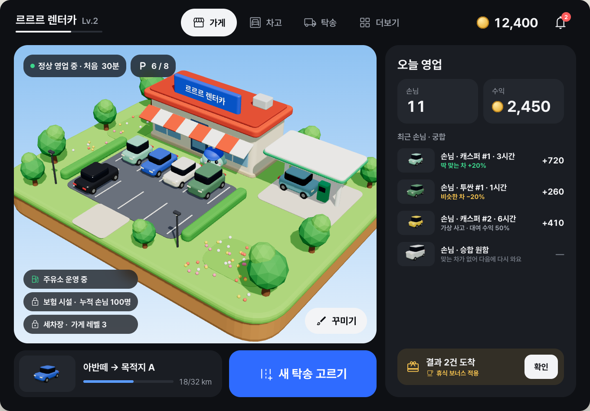
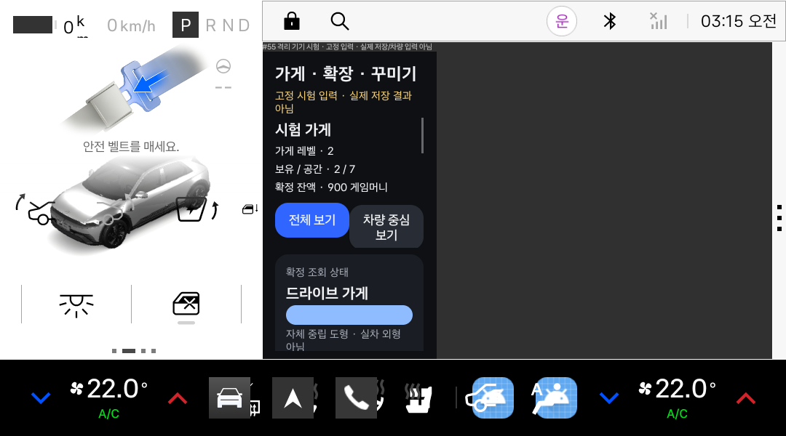

# 디자인 현황과 남은 제작 작업

확인일: 2026-11-10 KST · 공통 코드 기준: `main92dd2a34` 및 가게 전경 원본 `3dc3c8a`. 다른 화면의 과거 비교 기준은 `3a0181f`로 보존한다.

최신 표현 방향과 적용 시점은 [09의 사용자 결정](09_UI_UX_SPEC.md#1-ui-구현-기준과-산출물)을 따른다. 디자인팀의 최종 자산은 WIP이며 아래 Native Canvas/기존 Views는 기능 검증용 임시 표현이다. 자산 제공 전 추가 미술·전경 폴리싱을 진행하지 않는다. 아래 제작 목록은 현재 착수 지시나 최종 디자인 완료 판정이 아니다.

이 문서는 **계획한 모습, 현재 Android 화면, 아직 없는 디자인, 다음 제작 작업**을 정리한다. 화면·상태·행동의 기준은 [09 화면 명세](09_UI_UX_SPEC.md), 게임 규칙은 [01 PRD](01_PRD.md), 실제 실행 결과는 [06 검증 기록](06_VERIFICATION.md)에서 관리한다. 여기서는 그 규칙을 새로 정하지 않는다. 가게 모듈의 아래 부분 공급과 다른 화면의 미머지 작업을 구분한다. 제품 탐색/실제 저장 연결은 별도다.

## 1. 현재 상태

**기능별 표시 UI와 중립2D 가게 전경 모듈이 있다. 가게는 실제 큰/좁은 창의 독립 표시를 확인했으며, 실제 제품 상태·명령과 전체 화면 흐름의 연결이 남아 있다.**

| 구분     | 현재 있는 것                                             | 아직 필요한 것                               |
| ------ | --------------------------------------------------- | -------------------------------------- |
| 화면 설계  | 기본 와이어프레임, 세로 20장·가로 10장의 시안                        | 시안과 최신 기획의 차이 반영, 실제 앱 창에 맞는 최종 배치     |
| 표시 UI  | 차고·상세·도감·탁송·정산·시설·꾸미기·가챠·첫 실행·퀘스트·휴식의 Android Views | 화면별 최종 스타일 적용, 공통 탐색·실제 데이터·명령 연결      |
| 가게의 모습 | 가게 시안·중립2D 건물/차량/시설 전경·시작/첫확장 표현                        | 제품 홈/실제 저장 상태 연결·최종 자산 범위 보완     |
| 차량의 모습 | 자체 중립 차량 도형 2개                                      | 차량을 알아보고 수집의 차이를 느낄 수 있는 표현과 사용 가능한 자산 |
| 공통 스타일 | 어두운 배경·둥근 카드·파란 주요 버튼 일부 적용                         | 글꼴·정보 크기·간격·상태 표시·확인창의 화면 간 통일         |
| 최종 결과물 | 일부 기능별 Android 시험 캡처                                | 같은 제출 APK에서 연결된 전체 흐름의 캡처·시연           |

‘표시 UI 있음’은 고정 입력이나 외부 상태를 받아 화면을 그릴 수 있다는 뜻이다. 실제 구매·지급·저장·재실행까지 연결됐다는 뜻은 아니다.

## 2. 계획한 디자인은 무엇인가

- **가게 전체가 중심이다.** 주차장과 보유 차량, 시설을 함께 보여주고 가게가 커지는 변화를 확인한다. 차량 중심 보기로 수집 결과도 살펴본다.
- **가게 운영과 차량 수집을 화면으로 표현한다.** 차고에서 개별 차량을 고르고, 도감에서 수집 이력을 확인하며, 정산에서 주행·탁송·영업 결과를 확인한다.
- **기본 표현은 2D다.** 한 장의 배경과 차량·슬롯·시설 상태를 조합한다. 시안의 입체적인 그림이 실제 3D 엔진이나 모든 차종의 3D 모델 도입을 의미하지 않는다.
- **주차 중에 게임을 확인하고 조작한다.** 주행 중에는 게임 조작·보상 연출을 요구하지 않는다. 주행 제한과 복귀는 공통 화면 정책을 따른다.
- **시안의 분위기는 어두운 배경, 둥근 카드, 파란 주요 버튼이다.** 다만 v3 PNG 전체가 최종 승인·적용됐다는 뜻은 아니다. 차량·가게 그림과 예시 수치도 그대로 제품 자산·규칙이 되지 않는다.

기존 자료는 [와이어프레임](design-assets/wireframes.svg)과 [ui-v3 시안 30장](design-assets/ui-v3/)이다. 시안은 화면을 비교하는 자료이며, 부품별로 분리된 제작용 이미지나 Android 레이아웃 파일은 아니다.

## 3. 시안과 실제 화면이 다른 이유

| 비교 대상       | 무엇을 보여주는가                            | 현재 차이                                                               |
| ----------- | ------------------------------------ | ------------------------------------------------------------------- |
| 가게 홈 시안     | 완성 모습을 제안한 가게 전경·주차장·시설·요약 패널        | 임시 Native Canvas 전경이 제품 HOME에 부분 적용됐다. 최종 디자인팀 자산은 WIP이며 실제 거래 상태 연결은 별도다.                              |
| 가게 UI 시험 캡처 | 고정 시험 입력을 넣은 독립 `ShopView`의 표시·복원 시험 | 중립2D 가게/차량/시설 전경과 카드가 있다. 실제936dp/448dp 격리 호스트를 확인했으며 저장 가게나 최종 제품 홈은 아니다.                 |
| 현재 제품 홈 코드  | HOME ShopView·시험 출처 실제 SQLite 조회·화면선택/Back             | 임시 전경과 저장 조회는 제품 HOME에 부분 연결됐다. 실제 초기화/시설거래·NPC/프로세스 연결과 최종 디자인은 별도다.                 |
| 전체 Pleos 캡처 | 앱 창과 차량 시스템 화면을 함께 표시                | 왼쪽 차량 제어·상단 시스템 바·하단 공조 화면은 앱 디자인이 아니다. 앱에 실제 할당된 영역을 기준으로 배치해야 한다. |

**단순히 해상도만 맞추면 해결되는 차이가 아니다. 가게 중립2D 전경과 두 창 배치는 부분 공급됐으며, 제품 연결·최종 자산은 계속 필요하다.**

| 계획한 가게 홈 | 기존 가게 표시 UI 시험 |
|---|---|
|  |  |

오른쪽은 저장된 과거 시험 캡처다. 이번 문서 작성 중 최신 APK를 새로 실행한 결과가 아니다.

## 4. 화면별로 있는 것과 더 만들 것

### 가게·시설·꾸미기

| 항목 | 내용 |
|---|---|
| 계획한 모습 | 가게 전경과 차량이 중심. 확장·시설 설치·꾸미기를 하면 화면에서도 변화가 보인다. [가게 홈](design-assets/ui-v3/4u-landscape-shop-home.png), [시설](design-assets/ui-v3/4z-landscape-facilities.png) 시안이 있다. |
| 현재 있는 것 | `ShopView`의 상태·확인 흐름과 자체 Native Canvas 건물/차량/설치시설 전경, 전체/차량 보기·스크롤 복원. 고정 입력 시작1/3→첫확장2/5와 실제 큰/좁은 창을 검증했다. 제품 HOME/저장 조회는 부분 연결됐고 실제 가게 권위·시설/확장 거래는 별도다. |
| 아직 없는 것 | 실제 가게 권위/구매/설치 확정 결과와 프로세스 복원. 임의 장식 구매 정책은 미확정이다. |
| 더 만들 것 | 제공된 중립2D 전경을 제품 홈에 연결하고 실제 확정 상태를 공급한다. 최종 차종 자산·추가 꾸미기는 권리/범위에 맞춰 후속 적용한다. |
| 연결 작업 | 제품 HOME의 `ShopView`와 잔액/개체 조회는 부분 연결됐다. 실제 가게 권위·시설/확정 결과와 영속 복원을 이어야 한다. 표시만으로 결제·적용 성공을 만들지 않는다. |

### 차고·차량 상세·도감

| 항목 | 내용 |
|---|---|
| 계획한 모습 | 차량 카드에서 개체를 고르고 상세에서 희귀도·성장·활동·관리 행동을 확인한다. [차고](design-assets/ui-v3/4v-landscape-garage.png), [상세](design-assets/ui-v3/4e-vehicle-detail.png), [강화](design-assets/ui-v3/4f-upgrade-sheet.png) 시안이 있다. |
| 현재 있는 것 | `GarageView`·`CollectionView`, 개체 선택·상세·도감 상태·스크롤 보존·오류 표현. 차고·도감은 공통 탐색에 들어가 있고 저장 조회·표시 매핑도 일부 연결됐다. |
| 아직 없는 것 | 차종을 구별할 수 있는 최종 차량 자산, 개체 희귀도·성장의 일관된 시각 표현, 도감 전용 완성 시안. 기존 30장에는 별도 도감 시안이 없다. |
| 더 만들 것 | 차량 카드·상세·도감의 동일 차종 표현을 맞추고, 희귀도·현재 보유·과거 보유·발견·미발견을 구별하는 문구와 표식을 다듬는다. 차량 레벨을 실제 성능·안전성처럼 표현하지 않는다. |
| 연결 작업 | 강화·수리·판매·폐차의 비용 확인과 실제 명령·저장 결과를 연결한다. 버튼이나 callback 존재를 기능 완료로 보지 않는다. |

### 탁송·정산·첫 실행

| 화면 | 계획한 디자인·현재 있는 것 | 더 만들거나 적용할 것 | 별도로 남은 연결 |
|---|---|---|---|
| 탁송 선택·진행·변경·취소 | [확인](design-assets/ui-v3/4w-landscape-delivery-confirm.png)·[진행](design-assets/ui-v3/4x-landscape-delivery-in-progress.png) 및 변경·만료 시안. `DeliveryView`의 독립 표시·선택·확인 UI 있음 | 수익/구매 후보 카드, 선택 전후 비교, 변경 기회·처리 중·실패의 정보 위계를 최종 스타일로 맞춘다. 긴 목적지·좁은 창에서도 비용과 확정 버튼을 읽을 수 있게 한다. | 제품 탐색, 목적지 입력, 실제 후보·활성 의뢰·도착/정산 결과와 연결 |
| 정산·영업 결과 | [정산](design-assets/ui-v3/4y-landscape-settlement.png)·[상세](design-assets/ui-v3/4n-settlement-detail.png) 시안. `ResultsView`와 공통 탐색 연결 있음 | 수익 출처·획득 차량·영업 결과를 구분하고 짧은 결과 연출과 요약을 적용한다. 미확인/열람 완료·빈 결과·재조회 실패 표현을 통일한다. | 실제 각 기능의 확정 결과·저장·과거 기록 공급과 제출 흐름 검증 |
| 첫 실행·첫 차량 | [첫 실행](design-assets/ui-v3/5b-landscape-first-run.png) 시안. `OnboardingView`와 탐색 진입점 있음 | 선택 차량 비교 카드, 선택·확정·지급 결과, 첫 가게로 이어지는 짧은 안내를 같은 스타일로 완성한다. | 현재 호스트는 미지원 상태를 공급한다. 실제 최초 지급·프로필 초기화·복원 연결 필요 |

### 가챠·퀘스트·휴식·랭킹

| 화면 | 계획한 디자인·현재 있는 것 | 더 만들거나 적용할 것 | 별도로 남은 연결 |
|---|---|---|---|
| 가챠 | [가챠](design-assets/ui-v3/5a-landscape-gacha.png) 시안. `GachaView`·별도 호스트 있음 | 가격·확률·보장 안내를 최신 공급값으로 표시하고 추첨 전 확인·처리 중·차량 결과의 모습을 통일한다. 구 시안의 3,000을 그대로 복사하지 않는다. | 공통 탐색, 실제 권한·명령·저장 및 중단 복원 연결 |
| 퀘스트·업적 | [퀘스트·업적](design-assets/ui-v3/5c-landscape-quests-achievements.png) 시안. `ProgressView`의 독립 표시 UI 있음 | 진행·잠금·청구 가능·수령·만료를 한눈에 구분하고 목록·상세·보상 확인을 다듬는다. | 실제 정의·진행·보상·저장 결과 공급 |
| 휴식 | [휴게소](design-assets/ui-v3/4c-rest-stop-open.png)·[보너스 설명](design-assets/ui-v3/4t-rest-bonus-info.png) 시안. 휴식 상태 표시 UI 있음 | 주차 중에 조건·대기·적용·판정 불가를 차분하게 설명하는 카드와 문구를 다듬는다. 운전을 재촉하는 카운트다운·게임 알림을 새로 넣지 않는다. | 실제 휴식 판정·보상 상태 공급. 음성 허용·플랫폼 검증은 별도 기준 확인 |
| 랭킹 | [랭킹](design-assets/ui-v3/5d-landscape-ranking.png) 시안 있음. 확인한 앱 UI 경로에는 전용 랭킹 View 없음 | 실제 내 기록과 시연용 예시를 구분하고 지표·기간·누락/빈 목록·조회 실패를 연결한다. 최종 미술 작업은 디자인팀 WIP 기준을 따른다. | [PRD 1차 범위](01_PRD.md#1차-랭킹-범위) 확정, 실제 구현·검증은 미완료. 온라인 사용자 간 순위는 향후 연결 |

코드 확인 위치: [공통 탐색](../app/src/main/java/io/drivegrowth/app/MainActivity.kt), [기능별 UI](../app/src/main/java/io/drivegrowth/app/ui/). 이 표는 비교 기준 커밋의 코드 현황이며 이슈의 현재 담당·ready·종료 상태를 대신하지 않는다.

## 5. 이미지·글꼴·연출은 무엇이 필요한가

| 제작 대상     | 현재 자료                                                       | 필요한 결과물                                                   |
| --------- | ----------------------------------------------------------- | --------------------------------------------------------- |
| 가게 배경     | PNG 시안과 자체 Native Canvas 전경                                                | 실제 앱에서 사용할 배경과 차량·시설의 배치 영역. 좁은 창에서 잘릴 부분·유지할 부분도 정의      |
| 가게 확장 모습  | 공급 level1/2·공간3/5의 중립2D 표현/실제 창 검증                                                 | 시작 상태와 첫 확장 후를 구별하는 최소 자산. 모든 레벨별 그림을 먼저 만들 필요는 없음        |
| 차량 표현     | `garage_vehicle_placeholder.xml`, `shop_vehicle.xml`의 중립 도형 | 대표 차량부터 차종 구별이 가능한 표현. 확보한 자산의 출처·사용 조건 확인 후 확대           |
| 시설·꾸미기    | 시설 화면 시안                                                    | 시설별 식별 그림, 미설치·설치·잠금·선택·미리보기·확정 상태. 게임 수치의 밸런스 조정과 분리     |
| 아이콘·상태 표식 | 코드의 문구·카드·색상 일부                                             | 희귀도·활동·잠금·완료·미확인의 일관된 표식. 색상만으로 상태를 구분하지 않음               |
| 글꼴·정보 위계  | 기존 View는 시스템 글꼴 기반 표현 사용. 리소스 목록에서 전용 font 폴더 없음            | 기존 글꼴 유지 또는 사용 조건이 확인된 글꼴 선택. 제목·금액·본문·보조 문구의 크기·굵기·행간 통일 |
| 결과 연출     | 짧은 연출 후 요약이라는 방향                                            | 주차 중 첫 지급·정산·확장에 사용할 짧은 전환. 반복 재생·닫기·중단 복원 기준도 함께 적용      |

v3의 입체적인 가게·차량·캐릭터 그림은 시안용 임시 그림이다. 공식 현대차 이미지·로고·르르르 자산의 사용 허가를 확보한 것으로 보지 않는다. 자산 사용 조건은 [차량 조사](04_VEHICLE_RESEARCH.md)와 관련 조사 기록을 따른다.

## 6. 회의에서 정할 것과 바로 제작할 것

### 회의에서 필요한 디자인 결정

1. **최종 모습의 기준:** v3의 어떤 화면을 기준으로 삼고, 현재 기획과 다른 어떤 부분을 고칠지 선택한다. 2D Views 여부를 다시 정하는 회의는 아니다.
2. **가게와 첫 확장 모습:** 공급된 중립2D 시작/확장 표현을 실제 제품 상태와 연결하고 최종 자산의 추가 범위를 정한다.
3. **차량·시설의 그림 방식:** 확보한 사용 가능 자산을 기준으로 대표 차량과 시설의 표현을 정한다. 모든 차종의 3D 제작을 전제로 하지 않는다.
4. **공통 시각 기준:** 글꼴, 주요 정보 크기, 버튼·카드·상태 표식, 짧은 결과 연출의 느낌을 맞춘다.

차량 수집·가게 성장 중심, 주차 중 조작, 기존 기능 범위는 기존 결정을 유지한다. 경제 밸런스 세부 조정은 이번 디자인 제작의 선행조건으로 추가하지 않는다.

### 1차 제출 앱을 위해 진행할 순서

| 순서 | 할 작업 | 완료 확인 |
|---|---|---|
| 1 | 기준 시안과 실제 앱 창을 나란히 놓고 홈·차고·정산의 배치를 확정 | 앱에 할당된 창 크기에서 읽을 정보와 버튼 위치가 정리됨 |
| 2 | 제공된 가게 전경·시작/첫확장 표현의 실제 제품 연결 | 시작과 성장 후의 변화가 한눈에 보임 |
| 3 | 공통 글꼴·색·카드·버튼·상태 표시를 기존 Views에 적용 | 화면을 이동해도 같은 앱으로 보임 |
| 4 | 각 화면의 부족한 자산·도감 전용 배치·랭킹 View 등을 제작 | 정상 화면뿐 아니라 빈 목록·로딩·오류·잠금도 표현됨 |
| 5 | 실제 데이터·명령 연결과 시각 상태를 맞춤 | 확인 전 미리보기와 확정 결과가 구분되고 재실행 후 상태가 일치함 |
| 6 | 같은 제출 APK에서 실제 화면을 캡처하고 시안과 비교 | 창 크기·긴 글자·선택·주행 제한·주차 복귀를 확인하고 미검증은 공개함 |

이 순서는 제작·적용 제안이다. 별도 기능 제외나 새 담당 배정을 확정하지 않는다. 실제 분담·선행조건은 [08 진행 계획](08_PROJECT_PLAN.md)과 관련 이슈에서 관리한다.

## 7. 디자인 적용 완료를 판단하는 기준

- PNG를 보여주는 데서 끝나지 않고 실제 Android 화면에 적용돼 있다.
- 가게 전체와 차량 수집의 변화가 보이고, 임시 도형·시험 문구가 최종 자산인 것처럼 남아 있지 않다.
- 같은 기능의 시안·코드·실제 캡처가 같은 상태와 행동을 설명한다.
- 실제 앱 창에서 주요 정보·버튼이 가려지지 않고, 긴 글자·빈 목록·오류·처리 중 상태도 읽을 수 있다.
- 주행 중에는 게임 콘텐츠·입력이 공통 제한 정책에 따라 차단된다. 주차 복귀 뒤 선택·결과를 올바르게 복원한다.
- 고정 시험 입력 화면, 실제 저장 화면, 에뮬레이터와 실차 검증을 구분해 기록한다.

후속 화면·자산이 반영되면 해당 행의 현황과 근거를 갱신한다. 디자인 규칙이 바뀌면 먼저 09 명세를 고치고 이 문서에는 적용 상태만 반영한다.

2026-11-10 가게 모듈 부분 갱신: 코드26PASS와 정식9/부착창matrix2/첫확장2PASS·실제40채택프레임의 근거는 [06](06_VERIFICATION.md)을 따른다. 위 과거 시험 캡처와 달리 새 Native 전경이 구현됐지만 제품HOME/실제 store·명령/프로세스 완료는 아니다. 다른 화면의 과거 미완료 표는 해당 새검증 없이 완료로 바꾸지 않는다.
