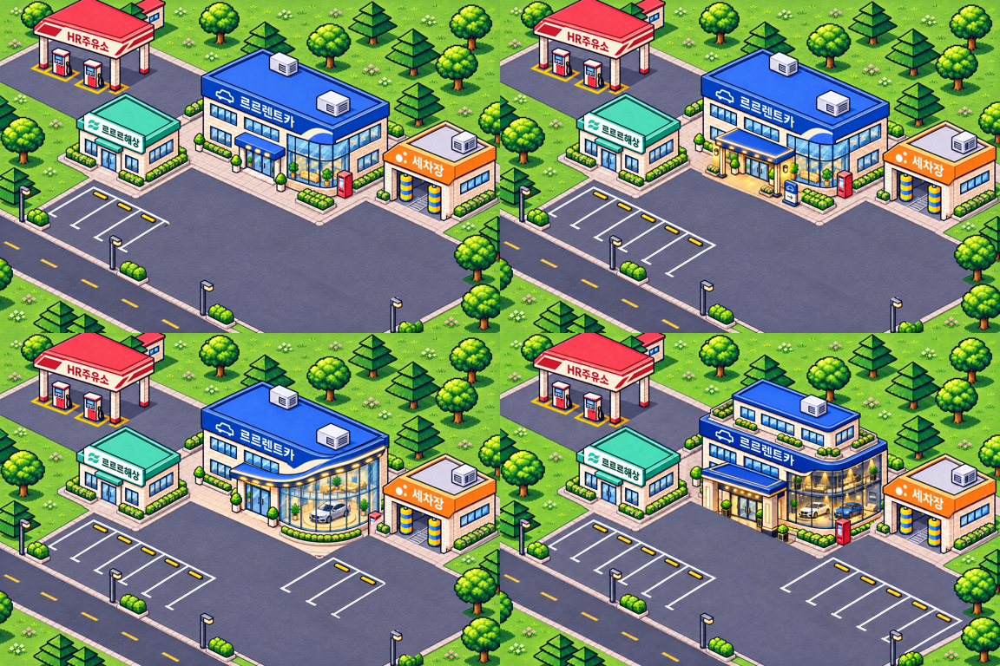
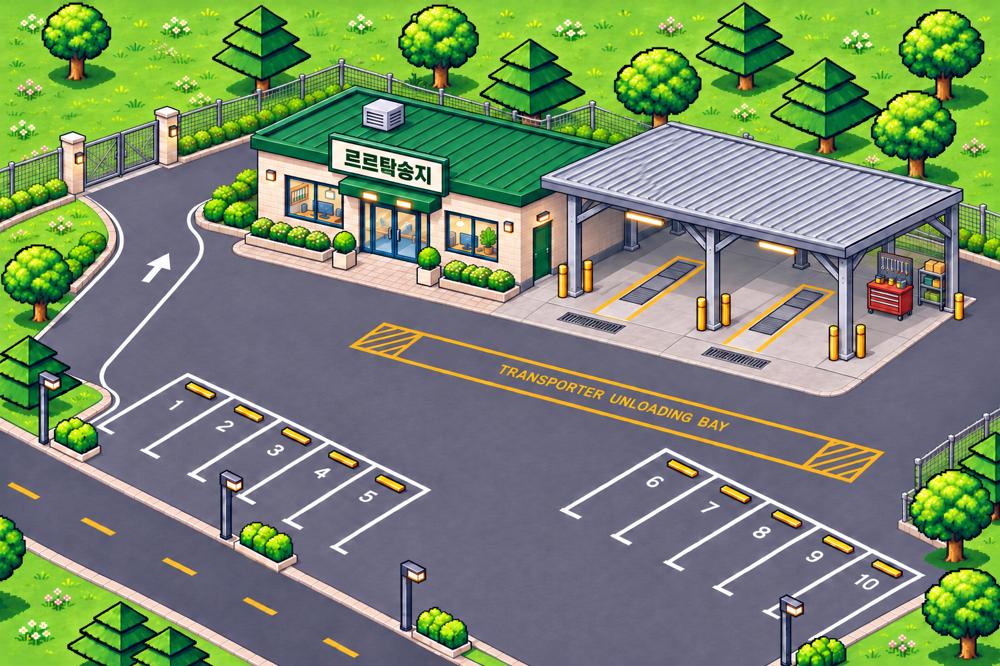

# 르르렌트카 성장과 르르탁송지

성장 배경은 Lv1~4 순서로 주차 3·5·7·10칸을 표시합니다. Lv2에는 조명과 안내판, Lv3에는 통유리 전시장, Lv4에는 3층과 테라스가 추가됩니다.

앱 적용용 배경은 town-lv1.png부터 town-lv4.png까지와 delivery-destination.png이며 모두 1536×1024입니다. 가게 화면에서 레벨에 맞는 배경을 선택하고, 수익 탁송 도착 연출에서 새 배경과 하역 위치를 연결해야 합니다.
