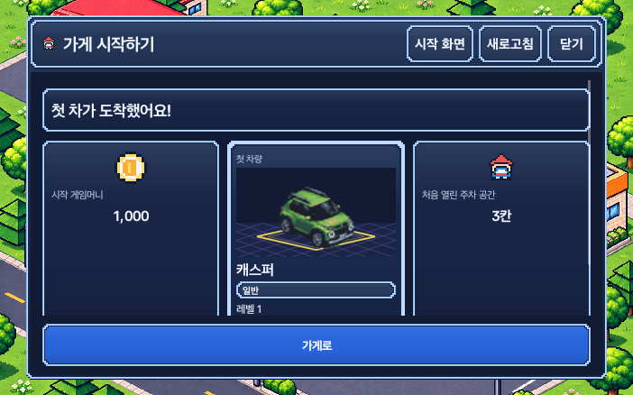

# 기존 저장을 보존하는 첫 차량 테스트 — 2026-11-15

코드 기준은 `6070445c154455c2b3f8c9e777ac2f5c04cb014b`, 기반 main은 `709e08dcb9e8be0f98c3ccfba2ba7b33b51f12f0`다. 제품의 지급·저장 로직은 변경하지 않았다. Debug 표시명 주입과 기존 격리 빌드 스크립트, 첫 지급 전후 프로세스 종료 회귀를 추가했다. [소스·APK 해시](metadata.json) · [독립 AI 검토](review-c-final.md).

## 앱 구분

| 용도 | 패키지 | 입력·저장 |
|---|---|---|
| 차량용 기존 앱 | `io.drivegrowth.app` | 실제 SDK 입력. 기존 설치와 데이터는 유지 |
| 표준 모의 Debug | `io.drivegrowth.app.simulation` | 기존 모의 패키지. 이 기기에서는 시험 전후 미설치 |
| 직접 플레이할 첫 차량 테스트 | `io.drivegrowth.verify.prototype.firstcarplay` | 별도 SIMULATION 프로필. 다른 앱의 저장을 읽거나 초기화하지 않음 |
| 자동 회귀 | `io.drivegrowth.verify.prototype.firstcarrecheck` | 사용자용과도 분리한 SIMULATION 프로필 |

설치·빌드·재실행은 [05 개발환경](../../05_DEVELOPMENT_SETUP.md)을 따른다. 모의 입력 시험은 실제 차량 주행·내비 도착·실차 검증이 아니다.

## 실행 결과

Pleos Connect 2.1.0 / API 34 ARM64, Android 사용자 10에서 같은 격리 설치를 유지했다.

| 단계 | 확인한 결과 | 근거 |
|---|---|---|
| 선택 후 확정 전 종료 | NEW, 보유 0대, 잔액 0, 전체 정산 0건. 표식을 남긴 PID 9449만 종료 | [표식](first-car-unconfirmed.json), [로그](01-unconfirmed.log) |
| 재진입 후 확정 | 새 PID 23902에서 같은 프로필. 캐스퍼 1대·잔액 1,000·공간 3칸·전체 INITIAL_GRANT 정산 1건 | [원결과](first-car-granted.json), [로그](02-grant.log) |
| 종료 후 저장 복원 | 새 PID 28196. 같은 프로필·차량·잔액·공간·정산/거래 식별자, 지급 이력 1건 유지 | [복원](first-car-restored.json), [JUnit 로그](03-restored.log) |

첫 두 단계는 표식 뒤 호스트가 프로세스를 종료하므로 `Process crashed` 종료 표시가 있다. 이를 JUnit 통과 2건으로 세지 않는다. 마지막 복원은 **JUnit 1건 통과, 16.862초**다. 전체 이력 검사는 소스의 `SettlementHistoryReader` 단언을 사용하며, 기존 제품 상수와 별개로 1,000·3을 기대한다.

보강 실행의 최초 두 번째 호출은 시험 시작 전 ActivityManager의 `remove task`로 종료됐다. 해당 구간의 앱 예외 스택은 확보하지 못했다. 같은 설치와 첫 표식에서 지급 단계를 재시도해 위 결과를 확인했으며 시스템 task 제거의 상위 원인까지 해결했다고 주장하지 않는다. 그 이전 회귀의 최종 복원 1건(20.633초)은 보강된 전체 이력 검사를 실행한 이번 결과와 구분한다.

## 실제 화면

위 화면은 자동 회귀 앱의 실제 지급 완료 View 캡처다. 사용자용 앱과 별도 패키지이며 실제 차량 SDK 결과가 아니다.

[복원 단언 직후 캡처](first-car-restored.png)는 빈 패널로 찍혔다. 해당 PNG를 복원 결과가 화면에 그려졌다는 근거로 사용하지 않는다. 원정산·표시 텍스트·가게 차량의 복원은 JUnit과 원결과 JSON으로 확인했고, 캡처 시점의 그리기 완료는 별도로 확인해야 한다.

## 보존·한계

[시험 전](protected-apks-before.json)과 [시험 후](protected-apks-resume-after.json)의 제품 설치 APK SHA-256·사용자 10 설치 상태·CE 데이터 디렉터리 inode가 일치한다. 제품 앱 삭제·데이터 삭제를 수행하지 않았고 표준 모의 앱도 설치하지 않았다. 이 비교를 제품 DB 파일 내용의 바이트 단위 대조로 확대하지 않는다.

기존 첫 차량 미표시 문의의 제품 DB는 읽지 않았으므로 그 저장의 원인을 확정하지 않는다. 이번 결과는 새 격리 프로필의 선택·한 번 지급·저장 복원 근거다. 실제 AppGrid 아이콘 터치, 기존 `onboardingcold56` 두 selector 재실행, 실제 차량·전원 시험은 이번 결과에 포함하지 않는다. 런처 intent 선언과 직접 Activity 실행은 별도로 구분한다.

새 테스트 앱을 처음부터 다시 사용하려면 승인된 테스트 패키지만 초기화한다. 제품 앱이나 기존 모의 앱의 저장을 삭제하는 절차로 사용하지 않는다. APK는 소스에 커밋하지 않으며 게시 시 GitHub Release와 해시 목록으로 제공한다. 개발 서명 차량용 APK는 마켓 제출용 서명·승인 완료를 뜻하지 않는다.
